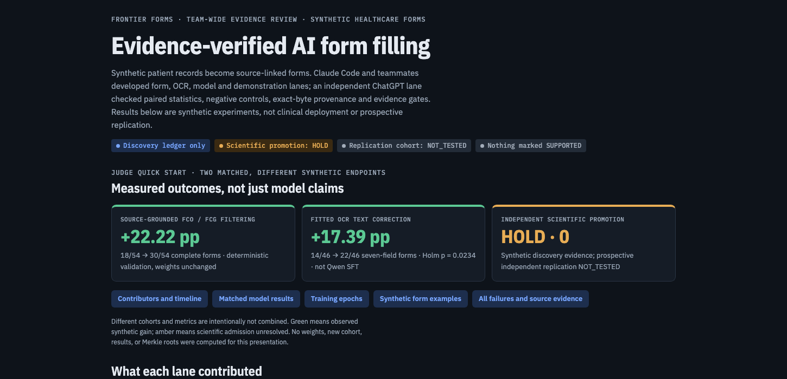
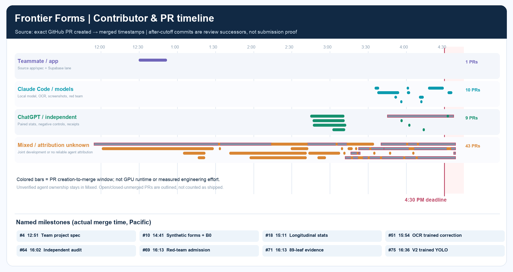
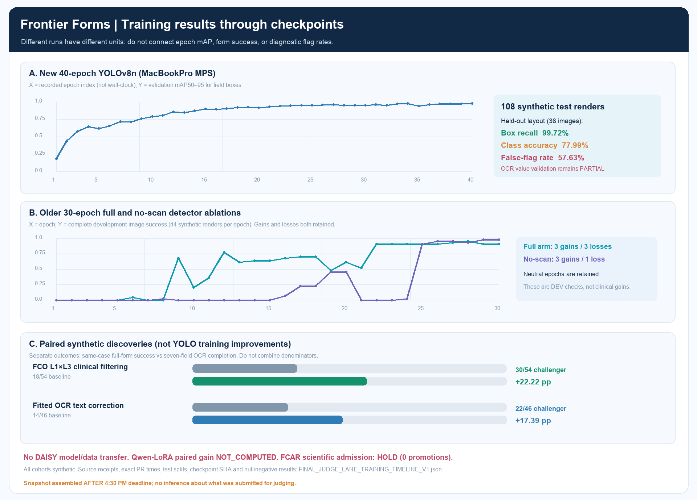
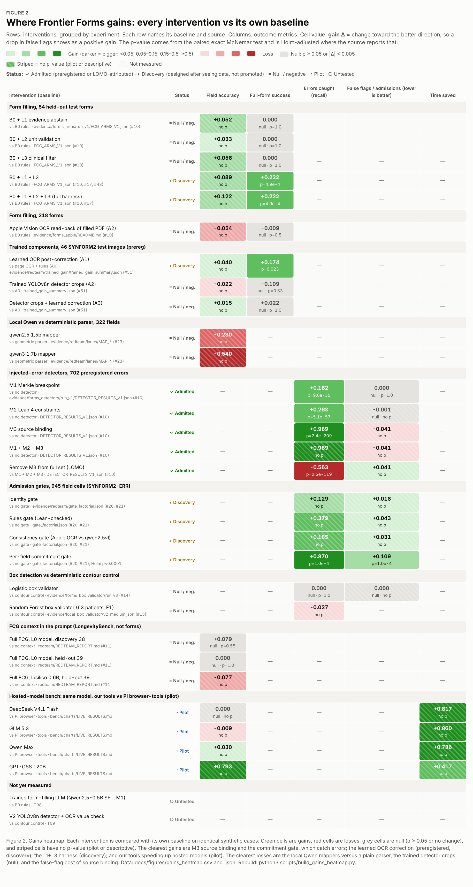
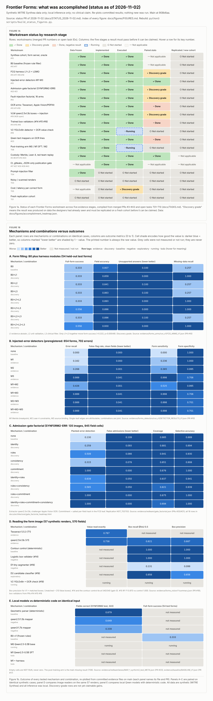

# Frontier Forms — Antigentic EHR Form Intake

> **All figures in one place (judges):** [docs/FIGURES.md](docs/FIGURES.md): every figure with a thumbnail, caption, source-data file and PR.

## Judges — start here: visual results and evidence

> **Video handoff (post-deadline research):** [Open the V3 presenter and Claude/ChatGPT evidence entry](docs/judges/VIDEO_REVIEW_ENTRY_20261102.md). The source-bound, local-only presentation and teammate responsibilities are documented there; it is not proof of the original competition submission.

### Frontier Forms — judge overview

**Two verified synthetic discovery comparisons:** deterministic FCO/FCG filtering **18/54 → 30/54 complete forms (+22.22 percentage points)**; fitted OCR correction **14/46 → 22/46 seven-field forms (+17.39 points; Holm p = 0.0234)**. These are separate denominators and mechanisms, **not** a Qwen neural fine-tuning improvement. Independent prospective scientific promotion remains **HOLD**.

[**Team-wide judge presentation — V3 encoding and attribution fix**](docs/judges/present_v3.html) · [Screenshot preview](docs/judges/figures/fig21_presentation_v3_preview_20261102.png) · [Corrected contributor Gantt](docs/judges/figures/fig20_contributor_gantt_corrected_v2.png) · [Training history](docs/judges/figures/fig19_actual_training_epochs_20261102.png) · [All evidence and figures](docs/FIGURES.md).

**Contribution lanes:** application/teammates; Claude Code OCR/model experiments; independent ChatGPT evidence checks; mixed/unknown attribution separately retained. This is a post-deadline research review, not proof of HackerSquad submission.

**Public data/merge coverage (post-deadline readback):** [Final exact-byte data availability and branch reconciliation](docs/judges/FINAL_PUBLIC_DATA_COVERAGE_20261102_V1.md) and [machine-readable source SHA256 audit](docs/judges/FINAL_PUBLIC_DATA_COVERAGE_20261102_V1.json). At frozen main f10e1d7: **60 PRs merged, 4 closed without merge, 0 open**; **13 remote branch refs remain NOT_MERGED**. One historical JSON failure receipt was preserved unchanged; outdated/duplicate code and a restricted binary were **not** blindly merged. Private weights, independent scientific replication and external submission acceptance remain **NOT_PUBLIC / NOT_TESTED / UNKNOWN**. This verifies published coverage, not that all data everywhere are available.

### Final review: contributor Gantt and measured training timeline

**[Main Notion research hub](https://app.notion.com/p/40c58ec71eb28161b79ddfbb083cb7c0)** · **[Notion judge figure gallery](https://app.notion.com/p/40d58ec71eb281db9ba2db19e7f7adf6)** · **[Detailed source-bound final review](docs/judges/FINAL_SUBMISSION_REVIEW_AND_TRAINING_20261102.md)** · **[Frozen PR and epoch source JSON](docs/judges/FINAL_JUDGE_LANE_TRAINING_TIMELINE_V1.json)**

**Corrected contributor Gantt:** actual GitHub PR creation-to-merge windows across teammate, Claude Code, independent ChatGPT, and mixed/unknown lanes. PR dates are **not engineering hours or model-training runtime**. Work merged after the 4:30 PM Pacific cutoff is shown as a later review successor, **not proof of a judged submission**.

[Full-size corrected Gantt](docs/judges/figures/fig20_contributor_gantt_corrected_v2.png) · [Frozen 63-PR timestamp snapshot](docs/judges/FINAL_PR_SNAPSHOT_20261102_V3.json) · [Preserved failed predecessor and repair receipt](docs/judges/FINAL_JUDGE_TIMELINE_PRESENTATION_CORRECTION_V2.json)

**Actual training results:** 40 new local YOLOv8n MPS epochs and **30 + 30 independently recorded** earlier full/no-scan epochs. V2 has per-epoch metrics but **no individual wall-clock timestamps**; the older two runs have source-recorded UTC. These are different runs, not one continuous curve.

[Full-size 100-epoch comparison](docs/judges/figures/fig19_actual_training_epochs_20261102.png) · [V2 detector receipt](evidence/forms_detector/V2-yolov8n/receipt.json) · [V2 40-epoch source metrics](evidence/forms_detector/V2-yolov8n/summary.json) · [All source-linked recorded epochs](docs/judges/FINAL_JUDGE_LANE_TRAINING_TIMELINE_V1.json)

**Measured, separate endpoints:** FCO L1×L3 full-form success **18/54 → 30/54 (+22.22 percentage points)**. Fitted OCR text correction all-seven-field success **14/46 → 22/46 (+17.39 points; Holm p=0.0234)**. New YOLOv8n V2 on **36 held-out-layout images**: box recall **99.72%**, matched class accuracy **77.99%**, and validator false-flag rate **57.63%**—therefore **PARTIAL**, not solved end-to-end. Earlier detector epochs include gains and regressions. Qwen LoRA paired generalization gain remains NOT_COMPUTED. **FCAR scientific promotion remains HOLD (0).**

**Attribution caution:** Known assignments are limited to PR descriptions and independently observed tool sessions; 43 of 63 PRs remain mixed/unknown in the frozen snapshot. The first Gantt omitted that row due to a display-label mismatch; its FAILED predecessor and the corrected successor are both preserved. Neither GitHub updates nor this Notion review proves the HackerSquad form was submitted.

**[Notion judge review: figures, results and team attribution](https://app.notion.com/p/40d58ec71eb281db9ba2db19e7f7adf6)** · **[Public GitHub figures and captions](docs/judges/FIGURES.md)** · **[Presentation guide](docs/judges/VIDEO_START_HERE_20261102.md)** · **[Self-contained judge presentation HTML](docs/judges/present.html)**

**On display below:** the source-linked results heatmap and accomplishment/status heatmap. These are real committed PNGs, visible directly in the public GitHub README without installing software or opening Notion.

### Measured improvements, failures, and untested cells

[Open full-size gains image](docs/figures/gains_heatmap.png) · [Open interactive HTML locally](docs/figures/gains_heatmap.html) · [Inspect source CSV](docs/figures/gains_heatmap.csv)

### What the team implemented and actually evaluated

[Open full-size accomplishment image](docs/figures/accomplishment_heatmap.png) · [Open all 17 synthetic example images](docs/judges/figures) · [Figure-by-figure captions and originating PRs](docs/judges/FIGURES.md)

**Results:** FCO L1×L3 improved synthetic complete-form success **18/54 → 30/54 (+22.22 percentage points)**. Fitted OCR *text correction* improved all-seven-field synthetic success **14/46 → 22/46 (+17.39 points; Holm p = 0.0234)**. YOLO crop alternatives were not supported gains; trained logistic bounding boxes tied the deterministic contour control. **Scientific promotion: HOLD** pending independent prospective replication. A Merkle root establishes receipt identity, not clinical accuracy.

**Contributors:** Claude Code and teammates produced the form pipeline, local experiments, OCR/model training and original examples. ChatGPT's parallel lane contributed independent paired-statistics review, Merkle/checkpoint audits, negative-result attribution and the source-bound discovery register. These statements do not assign unverified authorship to shared-account commits.

**Display limitation:** The PNGs and repo are public. Notion page content is verified through the connected workspace, but **anonymous Notion publication has not been established**; judges can always use the public GitHub images. The HTML files are GitHub source views, not publicly hosted interactive apps. To run locally, serve the checkout with \`python3 -m http.server 8787 --bind 127.0.0.1\`, then open \`http://127.0.0.1:8787/docs/judges/present.html\`.

### Ongoing training · pending SFT evidence

This is a live operational status block generated from the latest local SFT receipt. Read the per-run training, queued, stalled, failed or completed states below; no trained-Qwen superiority is admitted before validation-only checkpoint selection and held-out test scoring. Results here remain distinct from the completed FCO and fitted-OCR synthetic discoveries.

<!-- sft-status:start -->

## In progress (post-deadline, host-approved): trained form-filling model (SFT)

**What:** Qwen2.5-0.5B-Instruct + LoRA or DoRA (local magicSTUDIObox, Apple MPS, bf16 base, fp32 adapters, gradient checkpointing), fine-tuned on data/forms_sft_v1 (train / validation splits only). 5 configs are being trained.

**Protocol:** Each config keeps its lowest-validation-loss epoch, then is scored on the 38 validation forms only. The config with the best validation full-form success (ties: validation field accuracy) is chosen and scored once on the frozen 54-form test split. No retries on test. LoRA vs DoRA pairs share rank, lr and epochs.

**Comparison points (frozen 54-form test split):**

| Arm | Field accuracy | Full-form success | Source |
|---|---|---|---|
| M0 untrained Qwen2.5-0.5B (zero-shot) | 41.7% (225/540 test fields) | 0/54 test, 0/38 validation | `evidence/forms_model/M0-zeroshot/summary.json (#62)` |
| B0 frozen rules | — | 33.3% (18/54) | `evidence/forms_arms/run_v1/FCG_ARMS_V1.json (#10)` |
| B0 + FCG harness (L1+L2+L3) | — | 55.6% (30/54) | `evidence/forms_arms/run_v1/FCG_ARMS_V1.json (#10, #17)` |
| N1 NVIDIA Nemotron-Mini 4B (zero-shot, local Ollama) | 41.5% (validation+test) | 0/92 validation+test | `evidence/forms_model/N1-nvidia-nemotron-mini-4b/summary.json` |
| M2 qwen3:1.7b (zero-shot, local Ollama) | 72.6% (validation+test) | 1/92 validation+test (1/54 test) | `evidence/forms_model/M2-qwen3-1.7b/summary.json` |

**Runs (status as of 2026-11-03T06:45:00Z):**

| Run | Config | Status | Val loss | Test field accuracy | Test full-form |
|---|---|---|---|---|---|
| S1 | LoRA r16, lr 2e-4, 2 epochs | done: validation 28/38 full forms (73.7%), field accuracy 95.0% (B0 19/38 on the same forms; McNemar p=0.012, selection phase only) | 0.0074 (epoch 2 kept; 1.017 before training) | — | — |
| D1 | DoRA r16, lr 2e-4, 2 epochs (NVIDIA weight-decomposed LoRA) | done: validation 28/38 full forms (73.7%), field accuracy 95.3%; same full forms as S1, +1 field. Took 2.8x S1's training time and 13x its scoring time on MPS | 0.0074 (epoch 2 kept; 0.986 before training) | — | — |
| S2 | LoRA r16, lr 2e-4, 4 epochs | training (started 06:34Z) | — | — | — |
| D2 | DoRA r16, lr 2e-4, 4 epochs | queued (earlier tries failed before training, see ATTEMPTS.json) | — | — | — |
| S3 | LoRA r32, lr 5e-4, 3 epochs | queued (earlier tries failed before training, see ATTEMPTS.json) | — | — | — |

**Results will appear in:** `evidence/forms_model/selection_v1/ (one folder per attempt: receipt, train_receipt, answers, summary; ATTEMPTS.json lists every try including failures)` · `evidence/FIGURES_LIVE.html (rebuilt as results land; evidence/FIGURES.html stays frozen for the judges audit)` · `docs/figures/gains_heatmap (Not yet measured row becomes measured)`.
Status data: [`evidence/forms_model/SFT_STATUS.json`](evidence/forms_model/SFT_STATUS.json); refresh with `python3 scripts/update_readme_sft.py`. Until a run is scored on test, no trained-model gain is claimed.

<!-- sft-status:end -->

<!-- nvidia-tooling:start -->
## NVIDIA used for comparison (post-deadline, host-approved)

We used **NVIDIA's open Nemotron-Mini 4B model as a comparison arm**. It filled the same synthetic forms as every other arm, with the same patient facts, prompt, oracle and scorer, so its numbers line up directly with B0, our harness and the Qwen models. It ran locally on Apple silicon (magicSTUDIObox) through Ollama, with no DGX, no CUDA, no NVIDIA-hosted inference, and no data upload. Machine-readable record: [`evidence/NVIDIA_TOOLING.json`](evidence/NVIDIA_TOOLING.json).

| Arm (validation + test, 92 forms) | Full forms correct | Field accuracy | Evidence |
|---|---|---|---|
| **N1 NVIDIA Nemotron-Mini 4B** (zero-shot, Q4_K_M, digest `ed76ab18…`) | 0/92 | 41.5% | [N1](evidence/forms_model/N1-nvidia-nemotron-mini-4b/) |
| M0 Qwen2.5-0.5B (zero-shot) | 0/92 | 41.4% | [M0](evidence/forms_model/M0-zeroshot/) |
| M2 qwen3:1.7b (zero-shot) | 1/92 | 72.6% | [M2](evidence/forms_model/M2-qwen3-1.7b/) |
| B0 frozen rules | 37/92 | 83.4% | [B0](evidence/forms_b0/run_v1/) |

Nemotron-Mini answered "ask the patient" on 473 of 920 fields where the record had a value, so it was cautious rather than wrong. Every raw answer is in its `answers.jsonl`.

Other NVIDIA pieces: **DoRA** (NVIDIA's weight-decomposed LoRA) is trained as LoRA-vs-DoRA matched pairs in the SFT runs above (`scripts/train_forms_sft.py --dora`). First pair, validation only: D1 DoRA fills 28/38 forms completely (95.3% fields), S1 LoRA 28/38 (95.0%). That is a tie on full forms, at 2.8x the training time and 13x the scoring time on Apple silicon. **Megatron-LM** source is pinned (`631e1463`) but not run, because it needs CUDA GPUs.
<!-- nvidia-tooling:end -->

---

> **VIDEO / TEAMMATE REVIEW:** [Start here—four-minute protocol, private vs hosted execution and actor comparison](docs/judges/VIDEO_START_HERE_20261102.md) · [color-coded interactive storyboard](docs/judges/VIDEO_EVIDENCE_STORYBOARD_20261102.html) · [10 frozen source receipts](docs/judges/VIDEO_EVIDENCE_MANIFEST_20261102.json). Serve the repository with localhost HTTP to render HTML. Both **FCO +22.22 pp** and **OCR correction +17.39 pp** have discovery evidence; prospective independently replicated scientific superiority remains HOLD. LOMO negatives and Merkle scopes are visible.

> **Start here (judges, 2026-11-02).** Current status, results and priorities: [docs/STATUS_2026-11-02.md](docs/STATUS_2026-11-02.md). Accomplishment heatmap: [docs/figures/accomplishment_heatmap.png](docs/figures/accomplishment_heatmap.png) (interactive: [.html](docs/figures/accomplishment_heatmap.html)). **Where we gain (colour-coded):** [docs/figures/gains_heatmap.png](docs/figures/gains_heatmap.png) (interactive [.html](docs/figures/gains_heatmap.html), cell data [CSV](docs/figures/gains_heatmap.csv)). Every figure and image with its caption and source PR: [docs/figures/FIGURES.md](docs/figures/FIGURES.md).
> Headline on 54 held-out synthetic test forms: B0 33.3% (18/54) full-form success; B0 + FCG harness 55.6% (30/54), admitted by the PI on 2026-11-02 with discovery provenance (not yet replicated); post-training arm not yet scored. Teammate bench pilot (same hosted model, Pi browser-tools vs our tools): DeepSeek V4.1 Flash median 92.0 → 16.8 s with fields 119/121 in both arms ([bench/charts/LIVE_RESULTS.md](bench/charts/LIVE_RESULTS.md)). Preregistered trained-gain test: learned OCR correction 14 → 22/46 all-fields-correct (Holm p=0.023, admitted by the PI); trained detector crops NULL. The measured gains arise from specific Frontier Forms interventions or a fitted OCR correction table; this is not proof of new neural architectures or worldwide novelty: see [Novel versus standard](docs/STATUS_2026-11-02.md#novel-versus-standard-where-the-gains-come-from). Every result, including null, negative and failed ones, is listed in Figure 1c of the heatmap. All data synthetic (MITRE Synthea). The sections below are the original pre-release protocol, and some of their NOT_TESTED rows have since been run (see the status file).

**Discovery admission and what is distinctive versus standard training:** [Source-backed standard-versus-project comparison](docs/judges/STANDARD_TRAINING_VS_FRONTIER_FORMS_DISCOVERIES.md) · [machine-readable gate and negative outcomes](evidence/admission/FF_DISCOVERY_AND_NOVELTY_V1.json). Scientific admission remains HOLD; A1 is fitted OCR post-correction, **not** Qwen neural fine-tuning.

**Repo:** https://github.com/biobitworks/frontier-forms
**Parent commit:** 67bf6b0ba51dc7ed792c139f37fcc648653611c4
**State:** PRE-RELEASE_EVIDENCE_PACKAGE; NO_LIVE_EHR_WRITE.

## Hackathon: real Pi baseline versus our harness

[Live multi-model horizontal charts and results](bench/charts/LIVE_RESULTS.md), updated as runs finish. [Original DeepSeek pilot and 20-second explanation](bench/charts/README.md). Same DeepSeek V4.1 Flash model, three synthetic medical forms, two patients, six matched cases per arm. Median completion: **92.0 s → 16.8 s (5.5× faster)**. Correct fields: **119/121 for both arms**. Mean estimated API cost: **$0.0269 → $0.0054 per form**. Small development pilot; no held-out or clinical superiority claim. [Sanitized paired metrics](bench/charts/paired_pilot.json).

## Business use case

Convert scanned/faxed medical forms into source-grounded, human-reviewed HL7 FHIR drafts with antigentic safeguards. A wrong field can cause rework and downstream clinical risk. This is a research prototype, not a clinical product and not a replacement for clinical judgment.

## Sources and integrations

| System | Role | Current scope |
|---|---|---|
| [MITRE Synthea](https://synthea.mitre.org/about) | Synthetic patient records and encounters, in CSV/FHIR/C-CDA | Local sample archive byte-frozen; rendered scanned forms NOT_TESTED |
| [Open Epic](https://open.epic.com/TechnicalSpecifications) | FHIR R4, SMART/OAuth2 specs, supported read/write resources | Documentation, not an OCR dataset; OAuth and reads NOT_TESTED; writes PROHIBITED |
| [NVIDIA Megatron-LM](https://github.com/NVIDIA/Megatron-LM) | NVIDIA GPU-optimized training framework | Source pinned at 631e146322af891b0c79b8d5a53bc579a69f01f3; GPU training NOT_TESTED |
| [Fireworks](https://fireworks.ai/pricing) | Serverless inference and usage-based cost comparison | Existing historic Braintona adapter; this EHR experiment NOT_TESTED |
| [Microsoft Document Intelligence](https://learn.microsoft.com/en-us/azure/ai-services/document-intelligence/overview) | Optional specialist OCR/layout arm | NOT_TESTED |
| [Antigence](https://github.com/biobitworks/antigence) | Independent challenge, MCP policy, admission and abstention | Prior component, new form-harness deployment NOT_TESTED |
| [Snyk](https://docs.snyk.io/developer-tools/snyk-cli/snyk-cli/getting-started-with-the-snyk-cli.md) | Code, dependency and integration security | Scan gate must have real receipt |

Synthea and Open Epic are not two paired OCR datasets. Labeled rendered forms must be generated with reproducible layouts, source field positions and held-out patient/template splits. Never send real PHI to public model APIs or this repository.

## Exact immutable FCO/FCG predecessor

15-leaf recomputed project Merkle root:
9e4d4df8aa7a887ecc8b792a1d099832b584c16f81ea821897fcd437f6fd3a9a

Predecessor dataset input Merkle root:
5f9a7e51f1ee03d70d34e99358fe14230efa396f7fd851df21f424e6843f61b1

13/13 source files independently checked on magicSTUDIObox; 728/728 input inclusion proofs independently replayed. SIGNATURE=NOT_SIGNED. MMR=NOT_COMPUTED. These prove file identity/inclusion, not clinical truth, causality or model competence.

**Frozen discovery only:** 38 matched cases. Local Liquid longevity 25/38; Insilico Qwen3-0.6B-Longevity 27/38. Exact two-sided McNemar p=0.6875. Both source and independent stratified-bootstrap intervals include zero. Superiority is NEGATIVE/FAIL. The older and successor bootstrap methods and receipts remain separately recorded.

The original frozen manifest declares public_export=NOT_AUTHORIZED. This PR includes a user-requested **metadata-only review export**, not authorization to publish raw model weights, patient records, protected gold-oracle values, dataset bytes, or private credentials.

## Reproducibility

Every notebook has Requirements, Data input, Data analysis, Data output and claim ceilings.

| Notebook | Focus | State |
|---|---|---|
| [EXP-000](notebooks/00_fco_merkle_replay.ipynb) | 15-leaf predecessor recomputation | Source metadata PASS |
| [EXP-001](notebooks/01_paired_mcnemar_bootstrap.ipynb) | Paired exact McNemar, bootstrap | Discovery negative |
| [EXP-002](notebooks/02_classification_auroc_fpr_fdr.ipynb) | FPR/FDR/TPR; AUROC missing scores | Partial; AUROC NOT_COMPUTED |
| [EXP-003](notebooks/03_lomo_harness_ablation.ipynb) | LOMO harness removal protocol | NOT_TESTED |
| [EXP-004](notebooks/04_synthea_to_fhir_contract.ipynb) | Fixture-only FHIR shape | No actual EHR operations |
| [EXP-005](notebooks/05_fireworks_pricing_roi.ipynb) | Rate formula, token ROI missing | Actual tokens NOT_COMPUTED |
| [EXP-006](notebooks/06_lean_gsd_gsigmad_admission.ipynb) | Formal and governance checks | Lean/GSD/gsigmad NOT_TESTED |

With Python 3.12+ and nbformat, nbclient, ipykernel, run:

    python3 scripts/verify_predecessor.py --bundle evidence/freeze/predecessor
    python3 -m unittest discover -s tests -v
    python3 scripts/execute_notebooks.py

A raw-source verify can be run locally on magicSTUDIObox with --source pointing at the existing frozen directory, but the public metadata replay does NOT recalculate source bytes.

## FCG experiment route

source bytes → SourceFCO → atom/occurrence/context FCO → typed FCG relationships → transformation receipt → measured claim → statistical gate → release artifact.

Future paired harness comparison: A0 closed frontier if event rules require; A1 fixed Fireworks serverless model + minimal tools; A2 same model/settings + Antigence/FCG; A3 local model is a system comparison, not a harness causal ablation; A4 NVIDIA training/post-training is separate.

Require directionally positive exact McNemar p<0.05, 95% stratified paired bootstrap lower bound>0, independent untouched replication, denominators for FPR/FDR, continuous scores for AUROC, authorized task success guardrail and source-backed token ROI. Do not preregister an outcome as true. All unexecuted actions remain NOT_TESTED.

See the experiment protocol, FCG chain, lab notebook, source-rights boundary, GSD phases and independent Claude review handoff in docs.

## Supabase upstream intake (reported, not frozen)
The user reports a dataset being built in Supabase. The project and schema are not yet linked to this repository, and its row count, sensitivity, source version and contents are UNKNOWN. We register this as a **prospective upstream source** in [the Supabase source contract](docs/protocols/SUPABASE_SOURCE_CONTRACT.md) and [the source-intake ledger](evidence/sources/supabase_source_intake.json). This does not replace the frozen LongevityBench root or authorize an export. EXP-007 checks that these unresolved gates fail closed. Only an observed consistent snapshot and separately computed Merkle commitment can advance the Supabase lane.

## Claude red-team lane (cloud session, append-only successor)

Branch `redteam/claude-fcg-local-ablation-20261102-cloud` (parent PR #3 head `da953450`). Independent re-verification of every
root above with separate code, matched local-model lanes (L0 Liquid longevity, L1 qwen3:1.7b, L2 qwen2.5vl:3b, L3 Insilico
checkpoint) over the frozen discovery (38) and heldout (39) partitions with FCO/FCG context, forged-leaf, removed-edge, prompt
injection, verdict and option-swap antigentic gates, a cold-restart replay, and a synthetic-form VLM extraction lane with a
deterministic FHIR draft scorer. Results, gates and claim ceilings: [docs/reviews/CLAUDE_REDTEAM_REPORT.md](docs/reviews/CLAUDE_REDTEAM_REPORT.md),
[docs/architecture/LEAF_GAIN_ATTRIBUTION.md](docs/architecture/LEAF_GAIN_ATTRIBUTION.md), [experiments/CLAUDE_LAB_NOTEBOOK.md](experiments/CLAUDE_LAB_NOTEBOOK.md).
Agent instructions: [README_AI.md](README_AI.md). A concurrent local Claude lane lives on `redteam/claude-fcg-local-ablation-20261102`
and is cross-checked, not merged.

Reproduce (container, no inference): `python3 scripts/redteam/execute_redteam_notebooks.py` → new `evidence/notebook_runs_redteam_v<N>/`.
Reproduce (magicSTUDIObox, private evidence dir): see `scripts/redteam/*.py` docstrings; only `*_PUBLIC.jsonl`/`*_META.json` leave the host.
Fireworks L4/L5, Snyk, NVIDIA training, live Supabase and Epic remain BLOCKED / NOT_TESTED in this lane.

## App-plane integration and red-team review
The project application baseline includes teammate [Supabase migration](supabase/migrations/20261102000000_initial_schema.sql) and [Synthea FHIR importer](scripts/import_fhir.py) merged from PR #4. The evidence workflow must not mutate that operational implementation without review. New review checks fail closed on exact frozen evaluation input byte mismatches; Jupyter reruns write new versioned receipt directories. The original predecessor Merkle root has not changed. Draft PR #5 reviews stable identity, nondestructive provenance and a canonical dataset snapshot; draft PR #6 provides a synthetic red-team comparison, not demonstrated improvements in live model accuracy.

## Post-merge custody hardening
The Claude synthetic freeze-red-team lane and independent design-review document were merged via PR #6 and PR #5. A follow-on review corrected an input-state spoofing flaw in the Claude verifier, added a regression test, and explicitly pinned the only permitted synthetic binary fixture by its exact SHA-256. This fixture tests custody, not clinical source data or model improvement. Existing frozen predecessor and prior review roots remain immutable.
