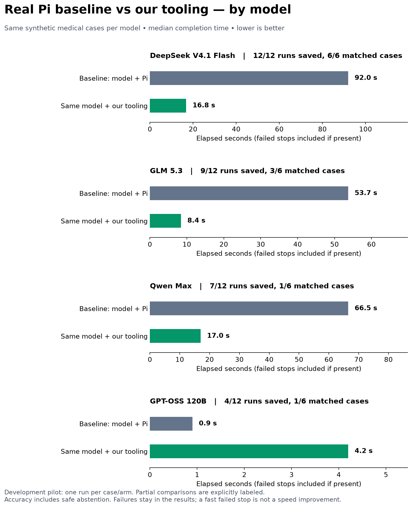

# Live model benchmark results

Real Pi + browser-tools versus the same model with Frontier Forms tools. Updated whenever a local run finishes. Only matched cases enter comparison bars; unfinished and failed cases remain visible below.

| Model | Runs saved | Matched cases | Median Pi → tools | Correct fields Pi → tools | Mean estimated API cost Pi → tools | Failures Pi / tools |
|---|---:|---:|---|---|---|---|
| DeepSeek V4.1 Flash | 12/12 | 6/6 | 92.0 → 16.8 s | 119/121 → 119/121 | $0.0269 → $0.0054 | 0 / 0 |
| GLM 5.3 | 9/12 | 3/6 | 53.7 → 8.4 s | 57/59 → 57/59 | $0.0957 → $0.0136 | 0 / 0 |
| Qwen Max | 7/12 | 1/6 | 66.5 → 17.0 s | 15/16 → 16/16 | $0.2057 → $0.0127 | 0 / 0 |
| GPT-OSS 120B | 4/12 | 1/6 | 0.9 → 4.2 s | 8/29 → 29/29 | $0.0003 → $0.0017 | 0 / 0 |

## Conditions and limitations

Three form types × two synthetic patients × two arms per model. Same hosted model ID per comparison, temperature zero and low reasoning effort. Shuffled cases; the first portion used three concurrent jobs, then the queue was increased to twelve for the submission deadline. This concurrency change can affect measured latency and is not a controlled speed comparison across models. Within-model bars use the exact same matched cases.

No held-out validation, repetitions, statistical confidence or clinical superiority is established. A partial result can change as more cases finish. If an arm fails or times out, its elapsed time must not be described as successful completion speed. Original DeepSeek [full pilot details](README.md) and [tooling explanation](TOOLING_WRITEUP.md).

[All sanitized run metrics](live_metrics.json) include completed single-arm cases before their counterpart finishes. Patient records, predictions, raw logs, failure messages and answer keys remain local. Receipt hashes identify the local artifacts.
