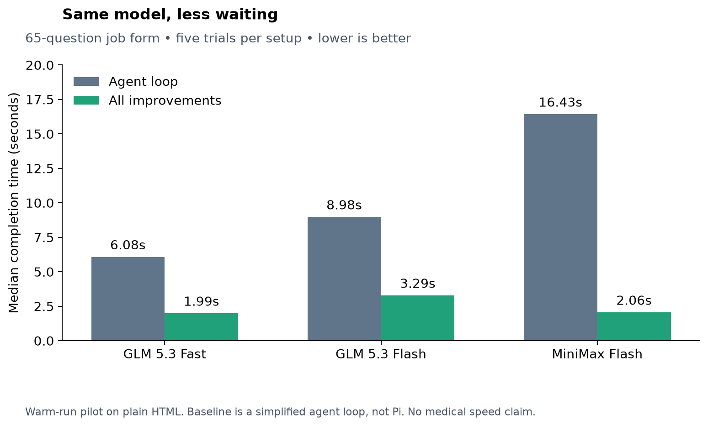
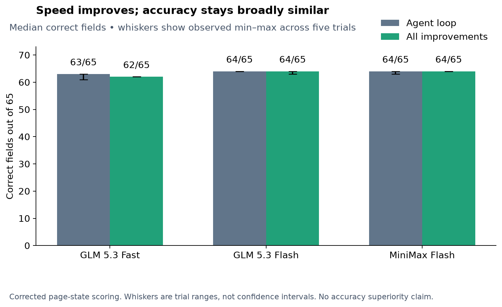
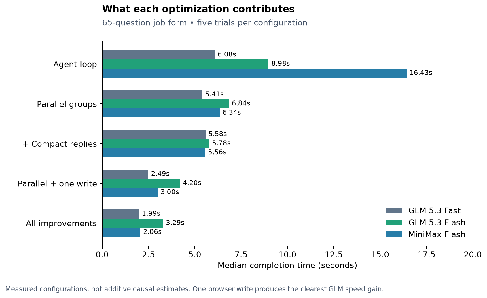

# Benchmark charts and submission explanation

## The 20-second explanation

> We speed up the work around the model: ask independent questions in parallel, request shorter answers, and fill the page in one browser operation. On our 65-question job-form pilot, the same GLM model went from 6.08 seconds to 1.99 seconds—about three times faster—with broadly similar accuracy. We are now testing this approach on synthetic medical forms; medical superiority has not been established.

## Measured speed improvement

| Same model | Agent loop | Optimized harness | Speedup | Time reduction |
|---|---:|---:|---:|---:|
| GLM 5.3 Fast | 6.08 s | 1.99 s | 3.06× | 67.3% |
| GLM 5.3 Flash | 8.98 s | 3.29 s | 2.73× | 63.4% |
| MiniMax Flash | 16.43 s | 2.06 s | 7.98× | 87.5% |

## Why it helps

1. **Ask together:** split independent questions into six concurrent groups, reducing serial waiting.
2. **Say less:** use compact answer lines instead of verbose JSON. This pilot omits evidence/confidence in compact output; medical answers need that information restored.
3. **Write together:** apply answers in one browser operation and read controls back, falling back to slower field filling when needed. No fallback was needed on these plain HTML forms.

## What the numbers establish

The charts use corrected saved aggregate results, not newly executed model runs. There are five trials for every plotted model/configuration. The full source contains 105 trials across both form sizes; these charts show the 75 trials on the 65-question form. Times are medians from warm runs; latency uncertainty and independent replication have not been established. Accuracy uses actual page state. The baseline is a simplified three-tool agent loop, not real Pi. These are harness speed measurements, not evidence that one model is intrinsically better, that FCG causes an improvement, or that medical accuracy improved.

Keep the medical lane separate: two preliminary Pi dev-form fills exist locally; there is no completed medical tools-versus-Pi comparison, fine-tuning result, or improvement-over-time study. The 280 oracle checks verify the form/scoring fixtures; they are not 280 successful model runs.

## Reproduce the charts

`python bench/plot_results.py` requires matplotlib and numpy; it makes no model calls. See [aggregate trial source](../results_ablation.jsonl), [plotted summary CSV](summary.csv), and [benchmark methodology](../README.md). PNG and SVG versions are provided for slides.

Source SHA-256: `2e0a05ad0b2d07510ba3d27314bbafc8357f9642a673861afe4ca9de4b928827`.
