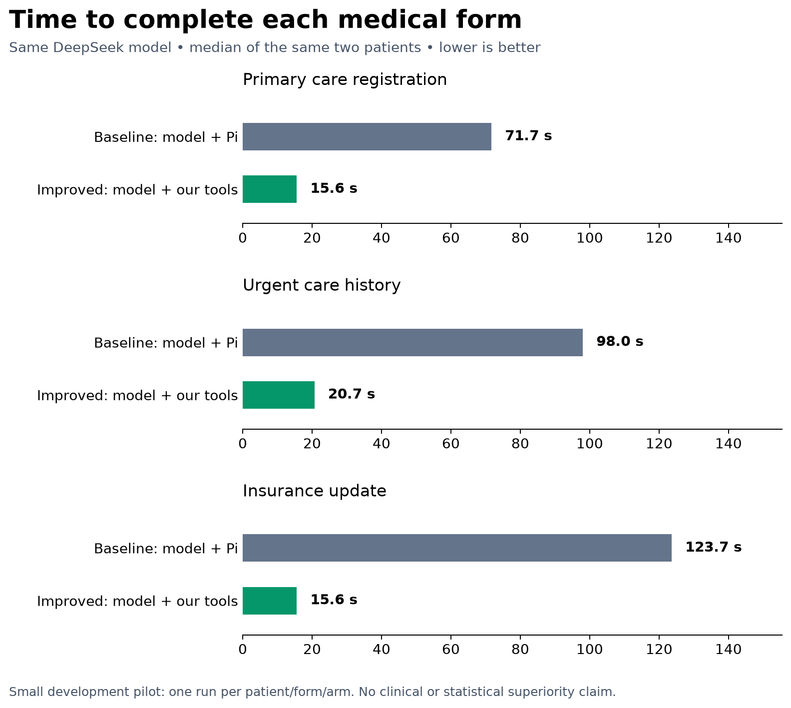

# Real Pi baseline versus Frontier Forms

**[Live multi-model results and horizontal chart](LIVE_RESULTS.md)** — new runs are added as they complete. The detailed results below describe the original completed DeepSeek pilot.

[Model-specific speed chart](model_speed.png) · [How the tooling achieves this](TOOLING_WRITEUP.md)

## Explain it in 20 seconds

> We used the same DeepSeek model on the same six synthetic medical-form cases. With Pi, the model operates the browser through general tools. With our harness, code handles form inspection, record retrieval, validation and page filling, and the model maps questions to answers. Median completion time fell from 92.0 to 16.8 seconds (5.5× faster). Field scores were 119/121 versus 119/121. This is a small development pilot, not a clinical validation.

## Exact setup

- Baseline: Pi 1.5.0 with the browser-tools skill and DeepSeek `deepseek-v4p1-flash` on Fireworks.
- Improved: Frontier Forms `packages/fill-tools`, using the same model/provider, temperature 0 and low reasoning effort.
- Same 3 form types, same 2 synthetic patients, same browser-state scorer and task restrictions; 12 runs total, 6 per arm. Shuffled order, up to 3 concurrent runs. One patient was used during development; this is not a held-out result.
- Timing covers harness execution from launch through completion, before the common scoring step. It excludes browser startup. Summaries use median time and mean cost/calls/tokens.
- Failures: 0/6 baseline, 0/6 improved. Full-form successes: 4/6 versus 4/6. Fabricated fields: 0 versus 0; unsafe fields: 0 versus 0.
- Mean tokens per form (uncached input + cached input + output): 509,160 versus 10,963. Estimated API spend is based on configured token rates, not an invoice.

## Accuracy and the absent-fact rule

The main score is neutral: unsupported Yes is wrong; defensible No/blank for an absent fact is excluded. Both arms use identical scoring. Missing/conflicted/expired facts, signatures and accidental submission are checked separately. Correct-field percentages include safe abstention; they are not the fraction of fields physically filled.

| Policy | Pi baseline | Our harness + tools |
|---|---:|---:|
| Neutral | 119/121 | 119/121 |
| Closed: absent means No | 119/135 | 120/135 |
| Open: absent means unknown | 133/135 | 132/135 |

## What changed

Our harness gives the model relevant record facts and structured questions in parallel batches. Code then validates proposed answers, applies them through browser controls, and verifies page state. Pi uses general browser operations and a longer agent conversation. These are two whole-system configurations; the pilot does not isolate each mechanism's contribution.

No medical accuracy superiority, fine-tuning gain or improvement-over-time claim is established. There is one run per case/arm, no confidence interval or independent replication, and no model weight digest from the hosted provider. Historical job-form charts are [separate](../job_form_charts/README.md); they are not the Pi baseline.

## Data and reproduction

[Sanitized paired metrics](paired_pilot.json) contain only numeric outcomes, opaque matched-case IDs and local artifact hashes; patient records, predictions, answer keys and transcripts stay private. [Summary CSV](summary.csv). Rebuild with `python bench/plot_pi_comparison.py` (matplotlib required). The underlying pilot is `bench/harness/pilot.py`; raw runs require the private frozen synthetic export and API access. Source snapshots and receipt hashes identify this pilot's provenance; they do not independently prove model outputs.
