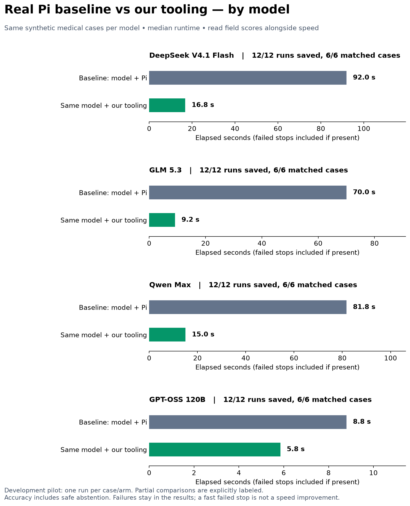

# How our tooling layer speeds up the same model

We compared DeepSeek V4.1 Flash running inside Pi with the same hosted model running through Frontier Forms' specialized form-filling pipeline. Both received the same synthetic patient records and the same six medical-form cases, with the same scorer reading the resulting browser state.

## Result

Median completion time fell from 92.0 seconds to 16.8 seconds: 5.5 times faster, or about 82% less time. Both configurations scored 119 of 121 fields correctly (98.3%). Average model calls fell from 16 to 3 per form, and estimated API cost fell from $0.0269 to $0.0054 per form, about 80% lower. Accuracy includes correct decisions to leave unsupported fields unanswered.

## What we changed

1. **Code reads the form.** Our inspector extracts visible questions and controls into a structured representation, including conditional and multistep forms. The model spends less of its conversation figuring out how to operate the browser.
2. **Give the model relevant facts.** The tooling selects patient-record facts for the current questions, preserving references the model can cite, instead of repeatedly carrying the entire record and growing browser history through an agent loop.
3. **Answer questions in parallel batches.** The model maps groups of questions to proposed answers. The implementation batches up to 12 fields and permits up to four concurrent mapping requests, reducing sequential model round trips.
4. **Code validates and applies answers.** The pipeline checks cited facts, option values, formats and unsupported answers, applies accepted answers through browser controls, and checks final visible values. It also handles progression through form steps and newly revealed questions.

The central change is moving routine browser work into reusable code while keeping the model focused on mapping questions to supported answers. This pilot compares the complete configurations; it does not establish how much of the improvement comes from each individual feature.

## Say it to a judge

“We kept the model the same and changed the workflow around it. Pi uses the model as a general browser operator. Our tooling reads the form, supplies relevant facts, batches questions, and validates and fills the answers. On six synthetic medical-form cases, that reduced median completion time from 92 seconds to 17 seconds, with the same field score and about 80% lower API cost.”

## Scope

This is one model, three synthetic form types, two patients, and one run per case per configuration: 12 runs total. It is a development pilot, not held-out replication or clinical validation. No fine-tuning occurred. API cost is estimated using configured token rates. GLM and MiniMax's earlier job-form experiments used a different baseline and are not included here. See [paired metrics](paired_pilot.json) and [full methodology](README.md).
