# All figures: one-click index for judges

Every figure on main, with a thumbnail, what it shows, its source data and the PR that produced it. All patient data is synthetic (MITRE Synthea). Research lanes used local inference only; the bench lane used Fireworks-hosted models.

Status words: **Admitted** = preregistered or LOMO-attributed. **Admitted (PI)** = admitted by Byron (PI) on 2026-11-02 with discovery provenance: designed after seeing the data, not yet replicated. **Null / negative** results are shown on purpose.

Interactive `.html` pages open best from a local checkout (`python3 -m http.server`, then browse to `docs/`). Every interactive page also has its data file linked here.

More detail: [status and novel vs standard](STATUS_2026-11-02.md#novel-versus-standard-where-the-gains-come-from) · [figure captions (Claude set)](figures/FIGURES.md) · [figure captions (judge set)](judges/FIGURES.md) · [input image sets](figures/FIGURES.md#image-sets-inputs-not-results)

### Final contributor and model-training timelines (source-backed review successors)

| Preview | Figure | Evidence and chronological meaning | Actual data |
|---|---|---|---|
| <a href="judges/figures/fig20_contributor_gantt_corrected_v2.png">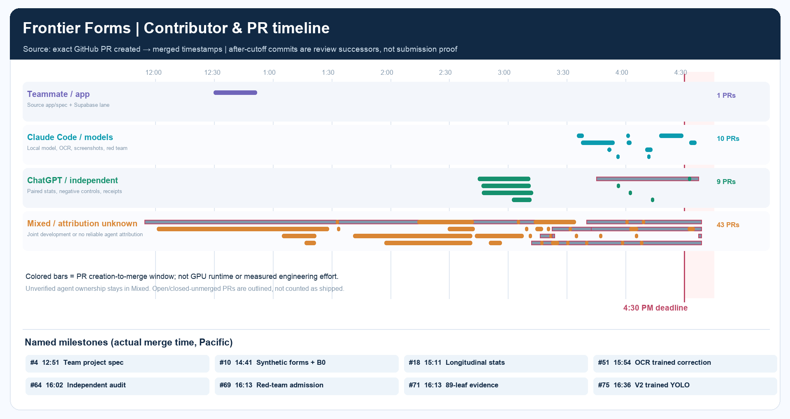</a> | [Corrected four-lane contributor Gantt](judges/figures/fig20_contributor_gantt_corrected_v2.png) | 63 PRs; team 1 clearly attributable, Claude 10, ChatGPT independent 9, 43 mixed/unknown. Creation-to-merge PR timestamps, NOT work hours. Original mislabeled chart preserved as a FAILED predecessor. | [Frozen timestamp snapshot](judges/FINAL_PR_SNAPSHOT_20261102_V3.json) · [correction receipt](judges/FINAL_JUDGE_TIMELINE_PRESENTATION_CORRECTION_V2.json) |
| <a href="judges/figures/fig19_actual_training_epochs_20261102.png">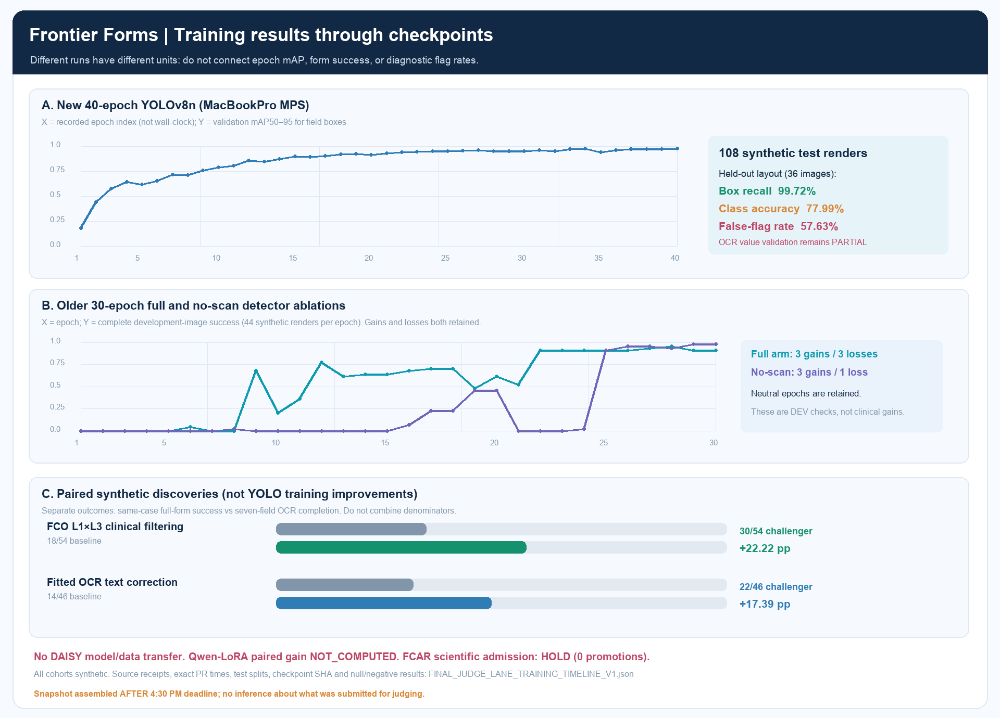</a> | [Actual training and discovery timeline](judges/figures/fig19_actual_training_epochs_20261102.png) | Three *different* training runs (40 + 30 + 30 epochs); V2 YOLO field-box mAP has no individual wall-clock epoch timestamps, older arms do; held-out class accuracy 77.99%, validator false-flag 57.63%. Discovery gains are separate endpoints. | [Source-linked training JSON](judges/FINAL_JUDGE_LANE_TRAINING_TIMELINE_V1.json) · [new V2 detector receipt](../evidence/forms_detector/V2-yolov8n/receipt.json) |

**Scope:** these visuals were prepared after the 4:30 PM Pacific competition deadline. They are post-deadline review material, not proof that any particular commit was submitted to HackerSquad. Scientifically replicated promotions remain zero.

### Judge presentation V3 — visual-only successor

[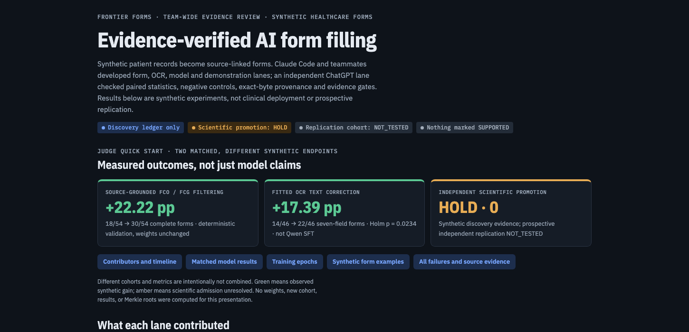](judges/present_v3.html)

**[Source-based presentation](judges/present_v3.html)** · [Full screenshot preview](judges/figures/fig21_presentation_v3_preview_20261102.png) · [Exact display/figure hashes](judges/PRESENTATION_VISUAL_V3_SUCCESSOR_20261102.json). V3 fixes encoding, contributor attribution and result-first hierarchy; frozen predecessor pages remain unchanged. Serve the checkout over localhost for interactive SVGs; GitHub provides only the source HTML.

## Headline figures

| Preview | Figure | What it shows | Source data | PR |
|---|---|---|---|---|
| <a href="figures/gains_heatmap.png">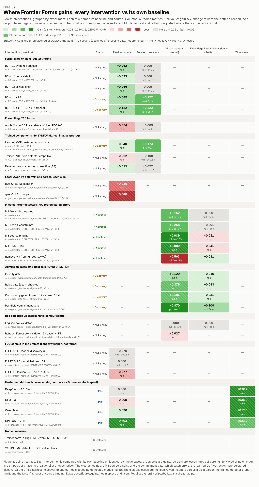</a> | [Figure 2: gains heatmap, every intervention vs its own baseline](figures/gains_heatmap.html) | Green = gain, red = loss, grey = null (p ≥ 0.05), striped = no p-value. Type column separates Novel (Frontier Forms mechanism) from Standard (off-the-shelf training/models). A project-specific intervention can show a gain without proving a globally novel algorithm. Rows marked Admitted (PI)* were admitted by the PI on 2026-11-02 with discovery provenance (not replicated). | [CSV](figures/gains_heatmap.csv) · [JSON](figures/gains_heatmap.json) | #65, #67 |
| <a href="figures/accomplishment_heatmap.png">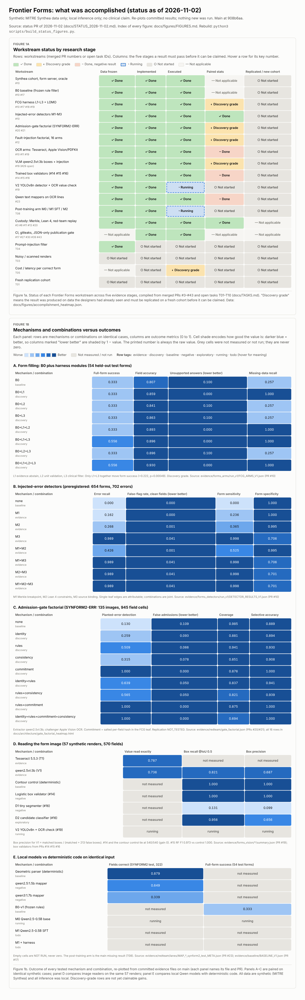</a> | [Figure 1: accomplishment heatmap (1a workstreams × stage, 1b mechanisms × outcomes, 1c ledger of every result)](figures/accomplishment_heatmap.html) | 1a status per workstream; 1b every tested mechanism re-plotted from committed evidence (panel F = hosted-model bench pilot); 1c every claim tested, including null, negative and failed. | [JSON](figures/accomplishment_heatmap.json) | #50, #57, #58, #67 |
| (interactive) | [Judges presentation page](judges/present.html) | Single page built from committed evidence: trained gain, gate factorial, epoch ledger, model comparison, full admission ledger. | `evidence/redteam/`, `evidence/admission/` | #72 |

## Judge figure set (static PNG)

| Preview | Figure | What it shows | Source data | PR |
|---|---|---|---|---|
| <a href="judges/figures/fig01_accomplishment_heatmap.png">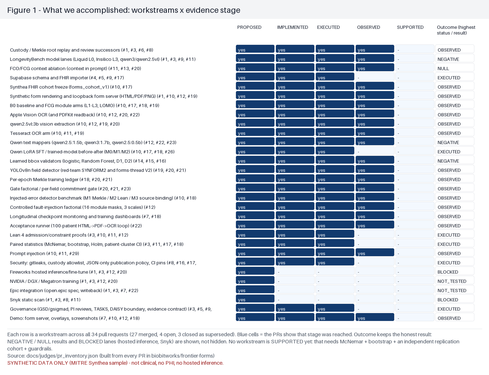</a> | [Fig 1: workstreams × evidence stage](judges/FIGURES.md#figure-1--what-we-accomplished-workstreams--evidence-stage) | Every workstream across the PRs; negative, null and blocked lanes kept. | `docs/judges/pr_inventory.json` | #51 |
| <a href="judges/figures/fig02_gate_factorial.png">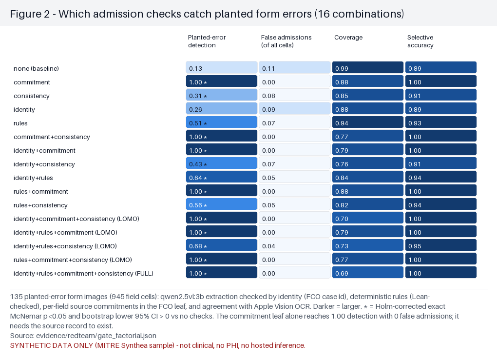</a> | [Fig 2: admission checks vs planted errors (16 combinations)](judges/FIGURES.md) | 135 planted-error images (945 cells). Commitment leaf alone: detection 1.00, 0 false admissions (descriptive; the Holm test covers image-level success). | `evidence/redteam/gate_factorial.json` | #20, #21, #51 |
| <a href="judges/figures/fig03_model_field_accuracy.png">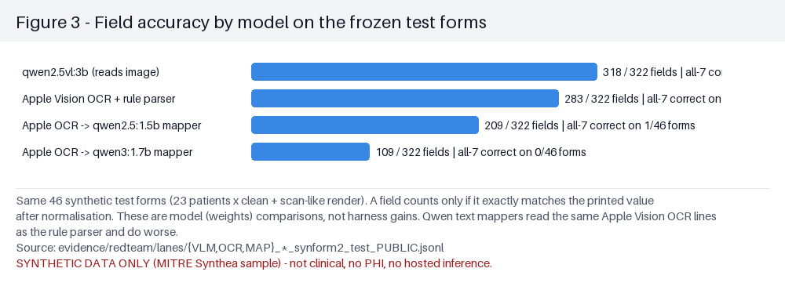</a> | [Fig 3: field accuracy by model](judges/FIGURES.md) | 46 synthetic test forms; model (weights) comparison, not a harness gain. Qwen text mappers do worse than the rule parser. | `evidence/redteam/lanes/*_synform2_test_PUBLIC.jsonl` | #23, #51 |
| <a href="judges/figures/fig04_epoch_ledger.png">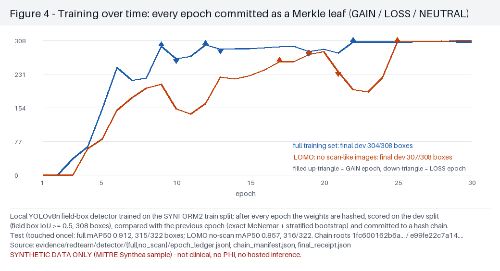</a> | [Fig 4: YOLOv8n training, every epoch a Merkle leaf](judges/FIGURES.md) | GAIN / LOSS / NEUTRAL per epoch on dev; test mAP50 0.912 (touched once). | `evidence/redteam/detector/*/epoch_ledger.jsonl`, `final_receipt.json` | #51 |
| <a href="judges/figures/fig05_promotions_and_negatives.png">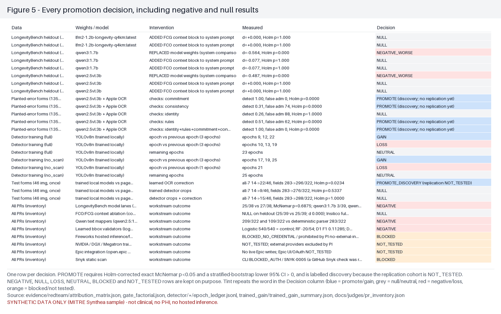</a> | [Fig 5: every promotion decision, including negative and null](judges/FIGURES.md) | One row per decision; PROMOTE needs Holm p<0.05 and bootstrap lower CI > 0. | `evidence/redteam/attribution_matrix.json`, `trained_gain_summary.json` | #51 |
| <a href="judges/figures/fig06_trained_gain.png">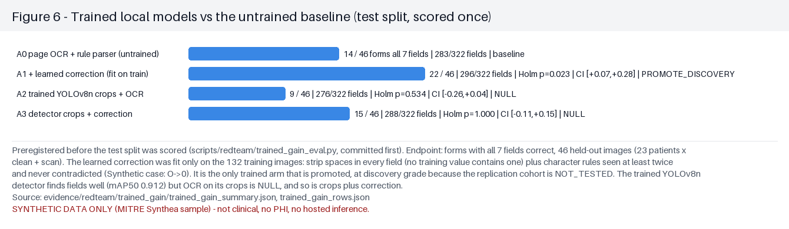</a> | [Fig 6: trained local models vs untrained baseline (prereg)](judges/FIGURES.md) | Learned OCR correction 14 → 22/46 all-7 (Holm p=0.023, admitted by the PI); detector crops NULL. | `evidence/redteam/trained_gain/trained_gain_summary.json`, `trained_gain_rows.json` | #51 |
| <a href="judges/figures/fig17_boxes_break_ocr.png">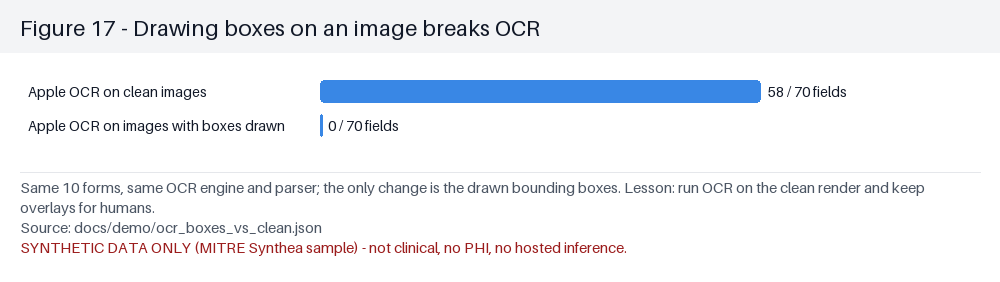</a> | [Figs 7–17: example forms, planted errors, model fills, boxes break OCR](judges/FIGURES.md#figure-7--a-clean-synthetic-intake-form-with-three-kinds-of-boxes) | Illustrations (single forms). Fig 17: Apple OCR reads 58/70 on clean renders vs 0/70 with boxes drawn. | `docs/demo/ocr_boxes_vs_clean.json`, `docs/demo/manifest.json` | #51 |

## Mechanism evidence (interactive)

| Preview | Figure | What it shows | Source data | PR |
|---|---|---|---|---|
| (interactive) | [Injected-error detector heatmap (M1 Merkle, M2 Lean 4, M3 source binding)](../evidence/forms_detectors/run_v1/heatmap.html) | 702 preregistered errors on 654 forms; M3 recall 0.989, unique LOMO contribution −0.563 (p=2.5e-119). | `evidence/forms_detectors/run_v1/DETECTOR_RESULTS_V1.json` | #10 |
| <a href="architecture/gate_factorial_heatmap.svg">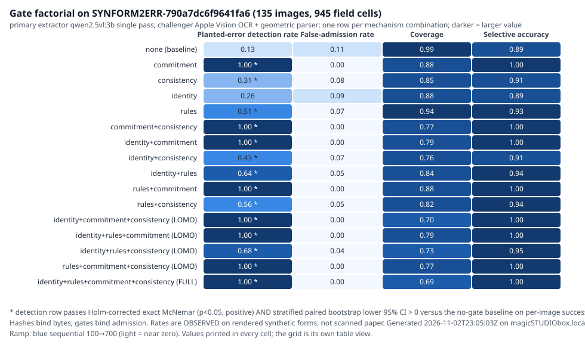</a> | [Admission-gate factorial (16 combinations × 4 metrics)](architecture/gate_factorial_heatmap.html) | Identity / rules / commitment / consistency gates on SYNFORM2-ERR. | `evidence/redteam/gate_factorial.json` | #20, #21 |
| (interactive) | [Fault-injection factorial, 16 module combinations at 3 scales](../experiments/form_error_factorial/heatmap.html) | Repairs are by construction; not a model gain. | `experiments/form_error_factorial/results/` | #12 |
| (interactive) | [Learned OCR correction ablation (independent replay)](judges/FIG12_OCR_CORRECTION_ABLATION_V1.html) | Independent replay of the A1 OCR-correction discovery. | `docs/judges/OCR_CORRECTION_SUCCESSOR_V2.json` | commit 04e6b0b |
| (interactive) | [Judge outcome heatmap: gains, losses and admissions (82 outcome leaves)](judges/JUDGE_OUTCOME_HEATMAP_V1.html) | Independent review: YOLO checkpoints, FCO single-leaf contrasts, detector contrasts, negative comparisons. | `docs/judges/JUDGE_OUTCOMES_SUCCESSOR_V1.json` | commit 04e6b0b |
| (interactive) | [Evidence, promotions and negative results ledger](../dashboard/outcome_promotion_ledger.html) | Every positive, negative and unpromoted outcome. | `docs/judges/PROMOTION_AND_NEGATIVE_RESULTS_V2_20261102.json` | #60 |
| (interactive) | [Training checkpoints vs FCO/FCG ablations](../dashboard/training_progress.html) | One real training point (epoch-0 val loss 1.005); no trained-LLM gain admitted. | `dashboard/` data | #18 |
| (interactive) | [Evidence-gate state over versions](../dashboard/training_heatmap.html) | Provenance dashboard, no performance claim. | `dashboard/` data | #7 |

## Hosted-model bench (pilot, Fireworks lane)

| Preview | Figure | What it shows | Source data | PR |
|---|---|---|---|---|
| <a href="../bench/charts/combined_benchmark.png">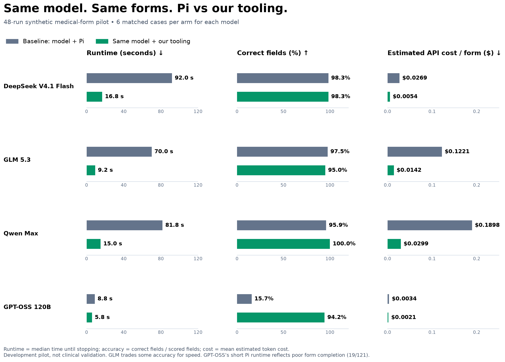</a> | [Runtime, accuracy and cost by model: Pi browser-tools vs Frontier Forms tools](../bench/charts/LIVE_RESULTS.md) | Same hosted model in both arms, 6/6 matched cases per model. DeepSeek 92.0 → 16.8 s, fields 119/121 both; GPT-OSS fields 19 → 114/121; GLM 118 → 115/121 (worse) at 70.0 → 9.2 s. No held-out set or statistics. | [live_metrics.json](../bench/charts/live_metrics.json) · [summary.csv](../bench/charts/summary.csv) · [paired_pilot.json](../bench/charts/paired_pilot.json) | bench lane |
| <a href="../bench/charts/model_speed.png">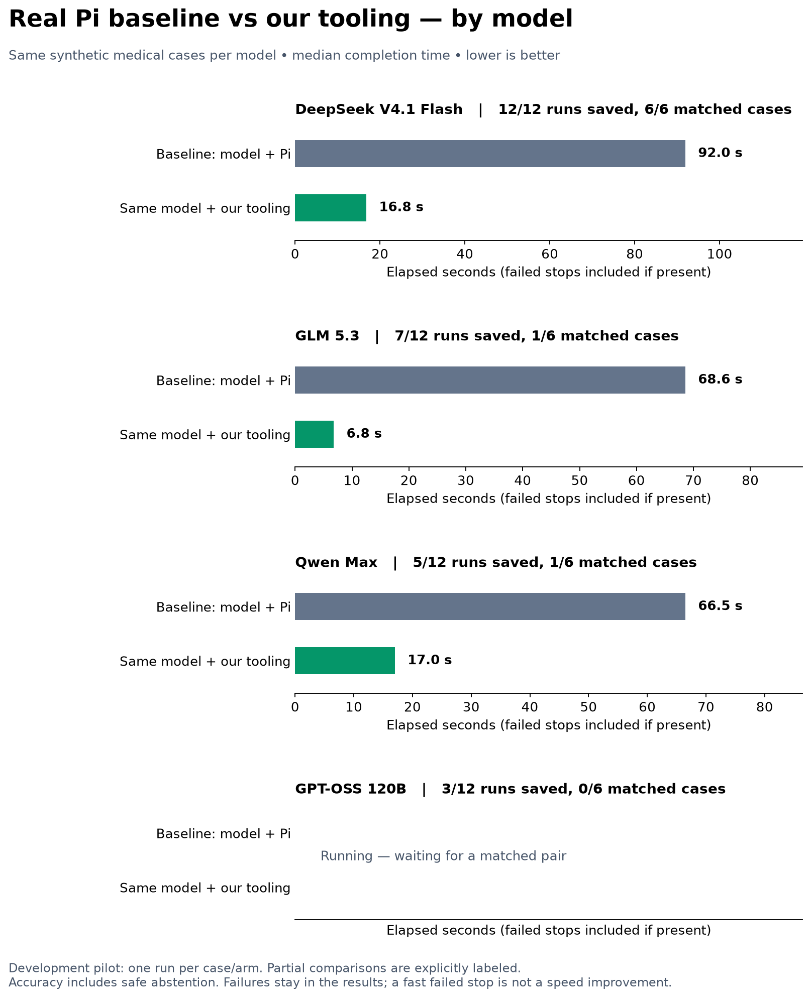</a> | [Model speed](../bench/charts/LIVE_RESULTS.md) | Median completion time per model, lower is better. | [live_metrics.json](../bench/charts/live_metrics.json) | bench lane |
| <a href="../bench/charts/baseline_vs_improved.png">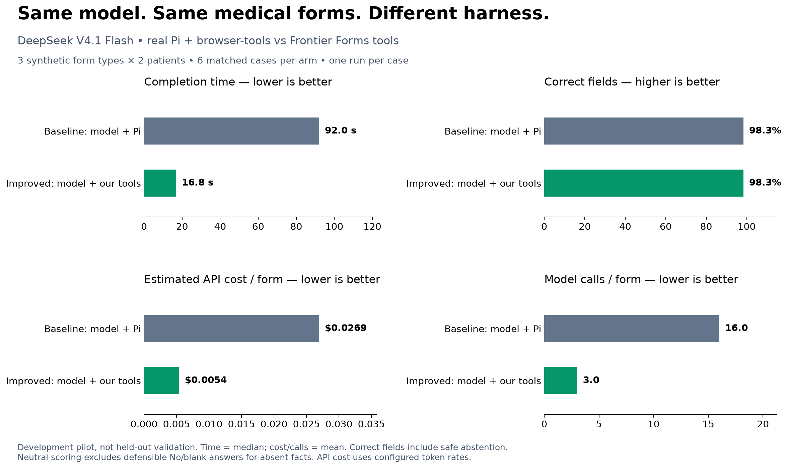</a> | [Original DeepSeek pilot: baseline vs improved](../bench/charts/README.md) | 2 synthetic patients × 3 forms. | [paired_pilot.json](../bench/charts/paired_pilot.json) | bench lane |
| <a href="../bench/job_form_charts/speed.png">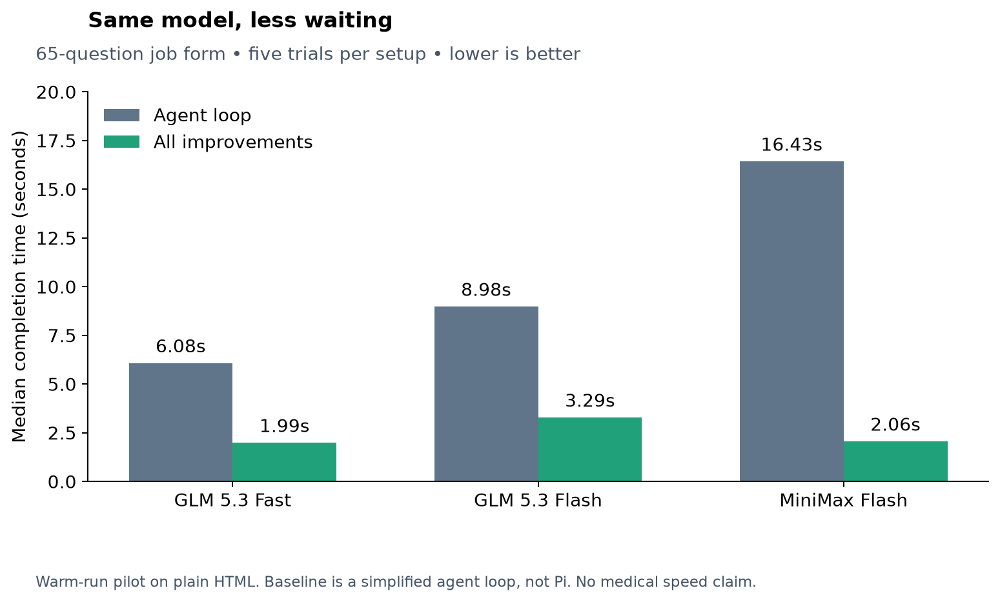</a> | [65-question job-form pilot: speed, accuracy, ablation](../bench/job_form_charts/README.md) | Not medical: GLM 5.3 Fast 6.08 → 1.99 s with broadly similar accuracy. | [summary.csv](../bench/job_form_charts/summary.csv) | commit c60feb1 |

## Timeline and video

| Preview | Figure | What it shows | Source data | PR |
|---|---|---|---|---|
| (interactive) | [PR, model and dataset Gantt (V2)](judges/FRONTIER_FORMS_GANTT_V2_20261102.html) | Every PR, model and dataset over time, with the A1 promotion and A2/A3 nulls. | `docs/judges/FRONTIER_FORMS_GANTT_EVIDENCE_V2_20261102.json` | #61 |
| (interactive) | [Video evidence storyboard (two lanes)](judges/VIDEO_EVIDENCE_STORYBOARD_20261102.html) | Four-minute walkthrough comparing the Claude and PI lanes. | `docs/judges/VIDEO_EVIDENCE_MANIFEST_20261102.json` | #70 |

## Image overlays

| Preview | Figure | What it shows | Source data | PR |
|---|---|---|---|---|
| (interactive) | [Form box overlays (gold / qwen2.5vl / Tesseract) and injected twins](../evidence/forms_vision/bbox_overlays_v1.html) | Canvas viewer over committed screenshots; inject version: [bbox_overlays_inject_v1.html](../evidence/forms_vision/bbox_overlays_inject_v1.html). | `evidence/forms_vision/*.json` | #29 lane |
| (interactive) | [One synthetic form: model answers over Apple Vision OCR boxes](../experiments/form_error_factorial/vision_overlay.html) | Illustration, n = 1 form. | `experiments/form_error_factorial/sample_vision/model_field_answers.json` | #12 |
