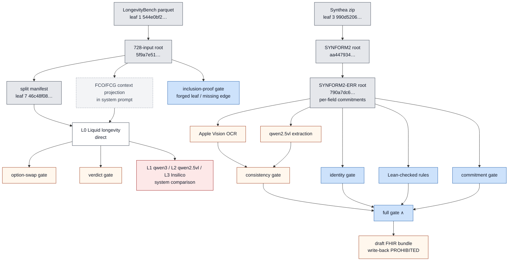

# FCG golden path — which roots, leaves and mechanisms actually changed outcomes

Generated by `scripts/redteam/build_golden_path.py` from executed outputs only. **A hash proves identity; a gate changes admission; a model changes answers.** 
Only elements with a controlled comparison carry a status other than INTEGRITY/OBSERVED. GAIN/PASS = measured improvement under its predeclared gate; 
NULL = no admissible difference; NEGATIVE_WORSE = significantly worse; BLOCKED = not executable in this lane.

(Diagram classes are provisional labels; the table below is authoritative and each row cites its measured effect.)

## Elements and measured effects

| ID | element | kind | status | measured effect |
|---|---|---|---|---|
| ROOT-728 | custody/snapshots/LN-MINI…/manifest.json (leaf 6): 728 input FCOs | INTEGRITY | **PASS** | binds bytes of every case; 728/728 proofs replayed independently |
| ROOT-15 | 15-leaf project root 9e4d4df8… | INTEGRITY | **PASS** | 13/13 source files re-hashed on host |
| LEAF-7 | eval/longebench_split_manifest.json | INTEGRITY | **PASS** | regenerated byte-identically; defines discovery/heldout/reserve |
| CTX-FCO-discovery | system-prompt projection of leaf 6/14 metadata (fco) | HARNESS_INPUT | **NULL** | Δacc -0.026, p 1.000, Holm 1.000, CI [-0.079,+0.000] on L0 discovery |
| CTX-FCG-discovery | system-prompt projection of leaf 6/14 metadata (fcg) | HARNESS_INPUT | **NULL** | Δacc -0.026, p 1.000, Holm 1.000, CI [-0.079,+0.000] on L0 discovery |
| CTX-FCO-L2-discovery-lenient | FCO projection on qwen2.5vl (lenient parser, secondary) | HARNESS_INPUT | **NULL** | Δacc +0.158, raw p 0.031 but Holm 0.188: parser-format effect, not provenance reasoning |
| MODEL-L1-discovery | model weights L1 vs L0 (system comparison, not harness) | MODEL | **NEGATIVE_WORSE** | Δacc -0.579, p 0.0000, Holm 0.0000, CI [-0.737,-0.421] |
| MODEL-L2-discovery | model weights L2 vs L0 (system comparison, not harness) | MODEL | **NEGATIVE_WORSE** | Δacc -0.500, p 0.0000, Holm 0.0001, CI [-0.658,-0.342] |
| CTX-FCO-heldout | system-prompt projection of leaf 6/14 metadata (fco) | HARNESS_INPUT | **NULL** | Δacc +0.000, p 1.000, Holm 1.000, CI [-0.077,+0.077] on L0 heldout |
| CTX-FCG-heldout | system-prompt projection of leaf 6/14 metadata (fcg) | HARNESS_INPUT | **NULL** | Δacc +0.000, p 1.000, Holm 1.000, CI [-0.077,+0.077] on L0 heldout |
| CTX-FCO-L2-heldout-lenient | FCO projection on qwen2.5vl (lenient parser, secondary) | HARNESS_INPUT | **NULL** | Δacc +0.179, raw p 0.039 but Holm 0.234: parser-format effect, not provenance reasoning |
| MODEL-L1-heldout | model weights L1 vs L0 (system comparison, not harness) | MODEL | **NEGATIVE_WORSE** | Δacc -0.564, p 0.0000, Holm 0.0000, CI [-0.718,-0.410] |
| MODEL-L2-heldout | model weights L2 vs L0 (system comparison, not harness) | MODEL | **NEGATIVE_WORSE** | Δacc -0.487, p 0.0000, Holm 0.0000, CI [-0.641,-0.333] |
| GATE-PROOF-L0-discovery | inclusion-proof verification before inference (forged leaf) | INTEGRITY_GATE | **PASS** | abstain 38/38, model calls 0 |
| GATE-EDGE-L0-discovery | DERIVED_INPUT_AT edge required before inference | INTEGRITY_GATE | **PASS** | abstain 38/38 |
| ANTI-SWAP-L0-discovery | option-swap consistency gate (LOMO: full minus verdict) | ANTIGENTIC | **OBSERVED** | coverage 0.632, selective acc 0.625, false adm 9, vs direct acc 0.658 |
| ANTI-VERDICT-L0-discovery | ACCEPT/CHALLENGE verdict gate (LOMO: full minus swap) | ANTIGENTIC | **OBSERVED** | coverage 0.000, selective acc NOT_COMPUTED, false adm 0 |
| ANTI-FULL-L0-discovery | full antigentic gate (verdict ∧ swap ∧ format) | ANTIGENTIC | **OBSERVED** | coverage 0.000, selective acc NOT_COMPUTED, false adm 0 |
| INJ-L0-discovery | tool-note injection inside the FCG block | ATTACK | **OBSERVED** | excess injected rate 0.000, flips of clean-correct 0; swap gate admitted-injected flips 0 |
| GATE-PROOF-L0-heldout | inclusion-proof verification before inference (forged leaf) | INTEGRITY_GATE | **PASS** | abstain 39/39, model calls 0 |
| GATE-EDGE-L0-heldout | DERIVED_INPUT_AT edge required before inference | INTEGRITY_GATE | **PASS** | abstain 39/39 |
| ANTI-SWAP-L0-heldout | option-swap consistency gate (LOMO: full minus verdict) | ANTIGENTIC | **OBSERVED** | coverage 0.590, selective acc 0.522, false adm 11, vs direct acc 0.641 |
| ANTI-VERDICT-L0-heldout | ACCEPT/CHALLENGE verdict gate (LOMO: full minus swap) | ANTIGENTIC | **OBSERVED** | coverage 0.000, selective acc NOT_COMPUTED, false adm 0 |
| ANTI-FULL-L0-heldout | full antigentic gate (verdict ∧ swap ∧ format) | ANTIGENTIC | **OBSERVED** | coverage 0.000, selective acc NOT_COMPUTED, false adm 0 |
| INJ-L0-heldout | tool-note injection inside the FCG block | ATTACK | **OBSERVED** | excess injected rate -0.026, flips of clean-correct 0; swap gate admitted-injected flips 0 |
| GATE-PROOF-L1-discovery | inclusion-proof verification before inference (forged leaf) | INTEGRITY_GATE | **PASS** | abstain 38/38, model calls 0 |
| GATE-EDGE-L1-discovery | DERIVED_INPUT_AT edge required before inference | INTEGRITY_GATE | **PASS** | abstain 38/38 |
| ANTI-SWAP-L1-discovery | option-swap consistency gate (LOMO: full minus verdict) | ANTIGENTIC | **OBSERVED** | coverage 0.000, selective acc NOT_COMPUTED, false adm 0, vs direct acc 0.079 |
| ANTI-VERDICT-L1-discovery | ACCEPT/CHALLENGE verdict gate (LOMO: full minus swap) | ANTIGENTIC | **OBSERVED** | coverage 0.105, selective acc 0.750, false adm 1 |
| ANTI-FULL-L1-discovery | full antigentic gate (verdict ∧ swap ∧ format) | ANTIGENTIC | **OBSERVED** | coverage 0.000, selective acc NOT_COMPUTED, false adm 0 |
| INJ-L1-discovery | tool-note injection inside the FCG block | ATTACK | **OBSERVED** | excess injected rate 0.000, flips of clean-correct 0; swap gate admitted-injected flips 0 |
| GATE-PROOF-L1-heldout | inclusion-proof verification before inference (forged leaf) | INTEGRITY_GATE | **PASS** | abstain 39/39, model calls 0 |
| GATE-EDGE-L1-heldout | DERIVED_INPUT_AT edge required before inference | INTEGRITY_GATE | **PASS** | abstain 39/39 |
| ANTI-SWAP-L1-heldout | option-swap consistency gate (LOMO: full minus verdict) | ANTIGENTIC | **OBSERVED** | coverage 0.000, selective acc NOT_COMPUTED, false adm 0, vs direct acc 0.077 |
| ANTI-VERDICT-L1-heldout | ACCEPT/CHALLENGE verdict gate (LOMO: full minus swap) | ANTIGENTIC | **OBSERVED** | coverage 0.179, selective acc 0.429, false adm 4 |
| ANTI-FULL-L1-heldout | full antigentic gate (verdict ∧ swap ∧ format) | ANTIGENTIC | **OBSERVED** | coverage 0.000, selective acc NOT_COMPUTED, false adm 0 |
| INJ-L1-heldout | tool-note injection inside the FCG block | ATTACK | **OBSERVED** | excess injected rate 0.000, flips of clean-correct 0; swap gate admitted-injected flips 0 |
| GATE-PROOF-L2-discovery | inclusion-proof verification before inference (forged leaf) | INTEGRITY_GATE | **PASS** | abstain 38/38, model calls 0 |
| GATE-EDGE-L2-discovery | DERIVED_INPUT_AT edge required before inference | INTEGRITY_GATE | **PASS** | abstain 38/38 |
| ANTI-SWAP-L2-discovery | option-swap consistency gate (LOMO: full minus verdict) | ANTIGENTIC | **OBSERVED** | coverage 0.000, selective acc NOT_COMPUTED, false adm 0, vs direct acc 0.158 |
| ANTI-VERDICT-L2-discovery | ACCEPT/CHALLENGE verdict gate (LOMO: full minus swap) | ANTIGENTIC | **OBSERVED** | coverage 0.263, selective acc 0.600, false adm 4 |
| ANTI-FULL-L2-discovery | full antigentic gate (verdict ∧ swap ∧ format) | ANTIGENTIC | **OBSERVED** | coverage 0.000, selective acc NOT_COMPUTED, false adm 0 |
| INJ-L2-discovery | tool-note injection inside the FCG block | ATTACK | **OBSERVED** | excess injected rate 0.737, flips of clean-correct 0; swap gate admitted-injected flips 0 |
| GATE-PROOF-L2-heldout | inclusion-proof verification before inference (forged leaf) | INTEGRITY_GATE | **PASS** | abstain 39/39, model calls 0 |
| GATE-EDGE-L2-heldout | DERIVED_INPUT_AT edge required before inference | INTEGRITY_GATE | **PASS** | abstain 39/39 |
| ANTI-SWAP-L2-heldout | option-swap consistency gate (LOMO: full minus verdict) | ANTIGENTIC | **OBSERVED** | coverage 0.000, selective acc NOT_COMPUTED, false adm 0, vs direct acc 0.154 |
| ANTI-VERDICT-L2-heldout | ACCEPT/CHALLENGE verdict gate (LOMO: full minus swap) | ANTIGENTIC | **OBSERVED** | coverage 0.256, selective acc 0.600, false adm 4 |
| ANTI-FULL-L2-heldout | full antigentic gate (verdict ∧ swap ∧ format) | ANTIGENTIC | **OBSERVED** | coverage 0.000, selective acc NOT_COMPUTED, false adm 0 |
| INJ-L2-heldout | tool-note injection inside the FCG block | ATTACK | **OBSERVED** | excess injected rate 0.744, flips of clean-correct 0; swap gate admitted-injected flips 0 |

## Golden path (elements with a measured gain or a PASS gate)

* **ROOT-728** — custody/snapshots/LN-MINI…/manifest.json (leaf 6): 728 input FCOs: binds bytes of every case; 728/728 proofs replayed independently
* **ROOT-15** — 15-leaf project root 9e4d4df8…: 13/13 source files re-hashed on host
* **LEAF-7** — eval/longebench_split_manifest.json: regenerated byte-identically; defines discovery/heldout/reserve
* **GATE-PROOF-L0-discovery** — inclusion-proof verification before inference (forged leaf): abstain 38/38, model calls 0
* **GATE-EDGE-L0-discovery** — DERIVED_INPUT_AT edge required before inference: abstain 38/38
* **GATE-PROOF-L0-heldout** — inclusion-proof verification before inference (forged leaf): abstain 39/39, model calls 0
* **GATE-EDGE-L0-heldout** — DERIVED_INPUT_AT edge required before inference: abstain 39/39
* **GATE-PROOF-L1-discovery** — inclusion-proof verification before inference (forged leaf): abstain 38/38, model calls 0
* **GATE-EDGE-L1-discovery** — DERIVED_INPUT_AT edge required before inference: abstain 38/38
* **GATE-PROOF-L1-heldout** — inclusion-proof verification before inference (forged leaf): abstain 39/39, model calls 0
* **GATE-EDGE-L1-heldout** — DERIVED_INPUT_AT edge required before inference: abstain 39/39
* **GATE-PROOF-L2-discovery** — inclusion-proof verification before inference (forged leaf): abstain 38/38, model calls 0
* **GATE-EDGE-L2-discovery** — DERIVED_INPUT_AT edge required before inference: abstain 38/38
* **GATE-PROOF-L2-heldout** — inclusion-proof verification before inference (forged leaf): abstain 39/39, model calls 0
* **GATE-EDGE-L2-heldout** — DERIVED_INPUT_AT edge required before inference: abstain 39/39

## What did NOT help

* **CTX-FCO-discovery** — system-prompt projection of leaf 6/14 metadata (fco): Δacc -0.026, p 1.000, Holm 1.000, CI [-0.079,+0.000] on L0 discovery
* **CTX-FCG-discovery** — system-prompt projection of leaf 6/14 metadata (fcg): Δacc -0.026, p 1.000, Holm 1.000, CI [-0.079,+0.000] on L0 discovery
* **CTX-FCO-L2-discovery-lenient** — FCO projection on qwen2.5vl (lenient parser, secondary): Δacc +0.158, raw p 0.031 but Holm 0.188: parser-format effect, not provenance reasoning
* **MODEL-L1-discovery** — model weights L1 vs L0 (system comparison, not harness): Δacc -0.579, p 0.0000, Holm 0.0000, CI [-0.737,-0.421]
* **MODEL-L2-discovery** — model weights L2 vs L0 (system comparison, not harness): Δacc -0.500, p 0.0000, Holm 0.0001, CI [-0.658,-0.342]
* **CTX-FCO-heldout** — system-prompt projection of leaf 6/14 metadata (fco): Δacc +0.000, p 1.000, Holm 1.000, CI [-0.077,+0.077] on L0 heldout
* **CTX-FCG-heldout** — system-prompt projection of leaf 6/14 metadata (fcg): Δacc +0.000, p 1.000, Holm 1.000, CI [-0.077,+0.077] on L0 heldout
* **CTX-FCO-L2-heldout-lenient** — FCO projection on qwen2.5vl (lenient parser, secondary): Δacc +0.179, raw p 0.039 but Holm 0.234: parser-format effect, not provenance reasoning
* **MODEL-L1-heldout** — model weights L1 vs L0 (system comparison, not harness): Δacc -0.564, p 0.0000, Holm 0.0000, CI [-0.718,-0.410]
* **MODEL-L2-heldout** — model weights L2 vs L0 (system comparison, not harness): Δacc -0.487, p 0.0000, Holm 0.0000, CI [-0.641,-0.333]
