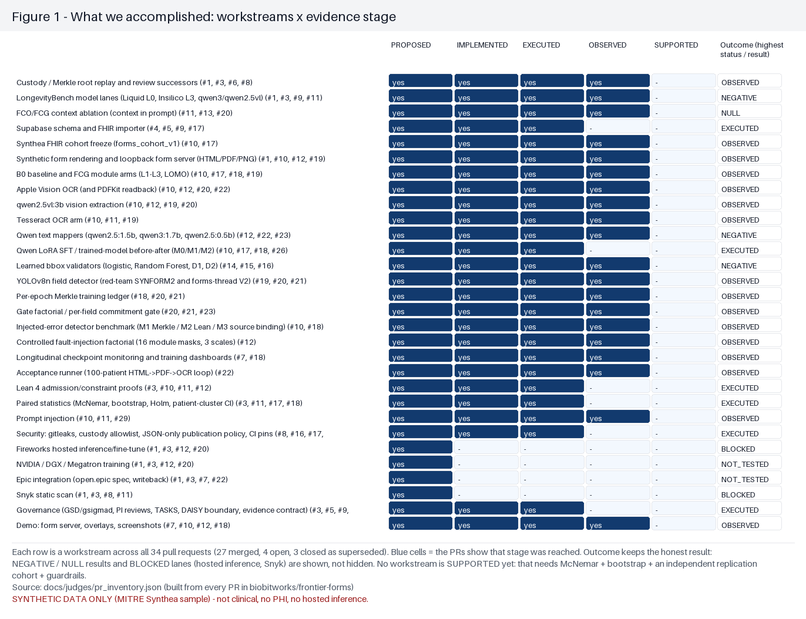
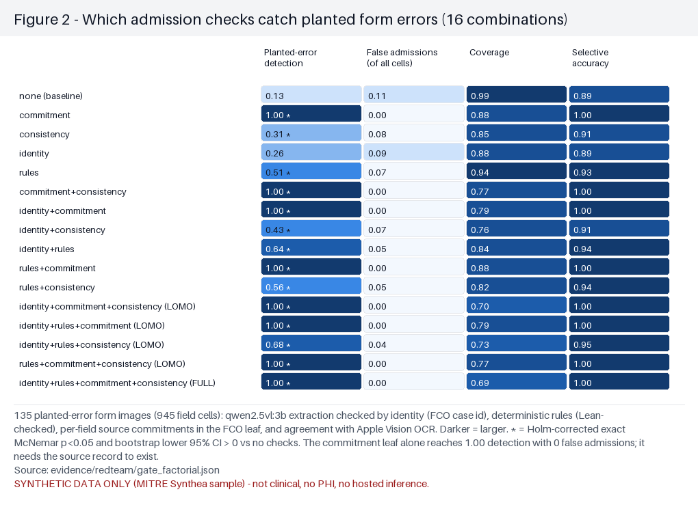
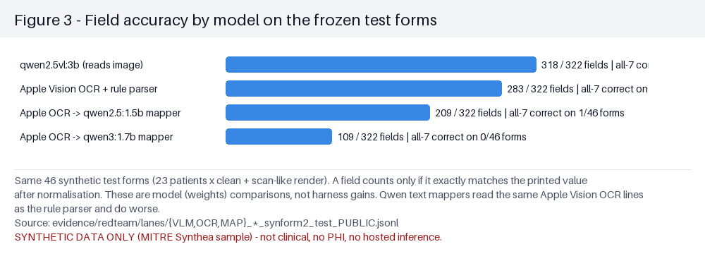
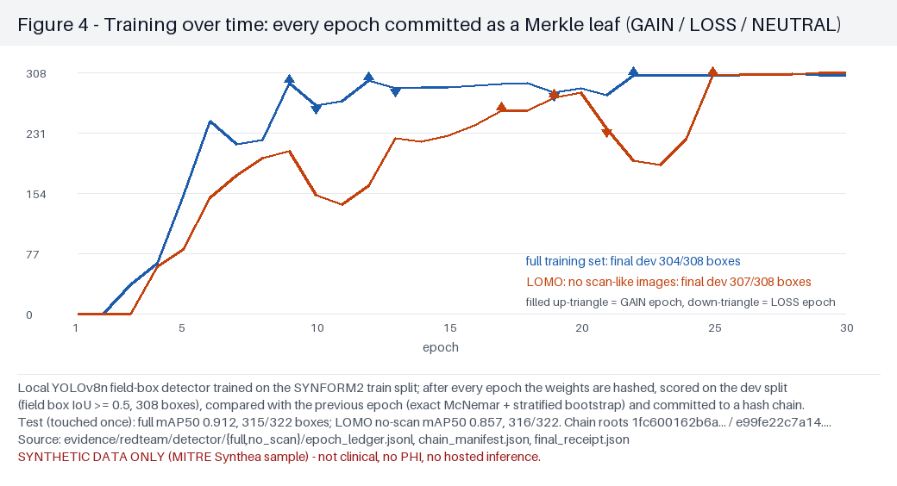
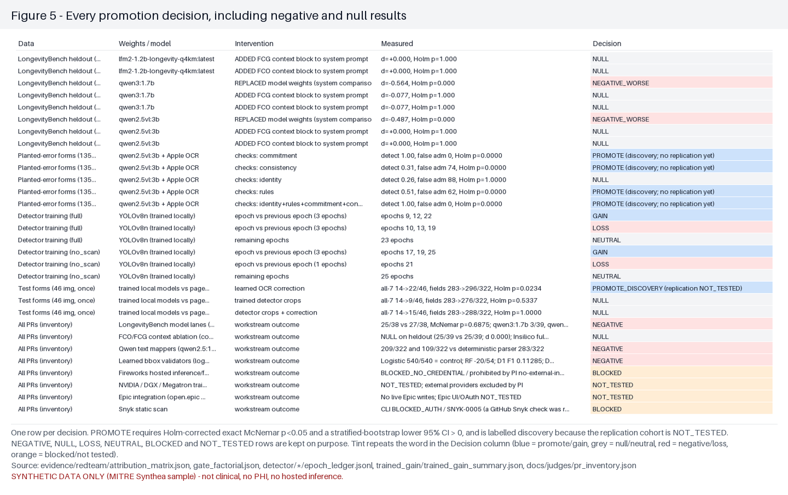
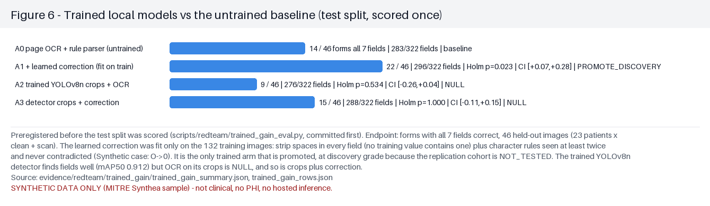
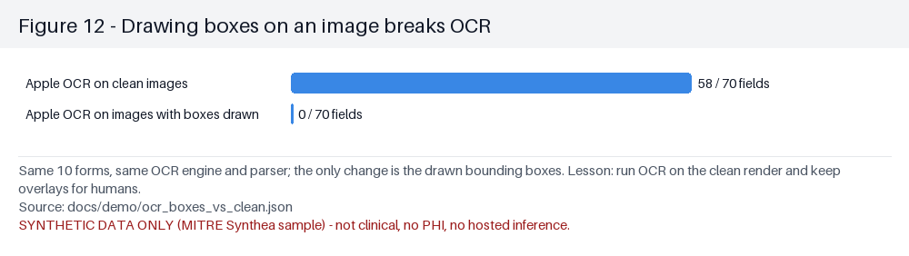

# Figures for judges

SYNTHETIC DATA ONLY (MITRE Synthea sample) — not clinical, no PHI, no hosted inference.

All figures are generated by `scripts/redteam/make_judge_figures.py` from files in this repository; captions state the data source.

## Figure 1 — What we accomplished: workstreams × evidence stage

Each row is a workstream across all 34 pull requests (27 merged, 4 open, 3 closed as superseded). Blue cells = the PRs show that stage was reached. Outcome keeps the honest result: NEGATIVE / NULL results and BLOCKED lanes (hosted inference, Snyk) are shown, not hidden. No workstream is SUPPORTED yet: that needs McNemar + bootstrap + an independent replication cohort + guardrails.

*Source:* `docs/judges/pr_inventory.json (built from every PR in biobitworks/frontier-forms)`

## Figure 2 — Which admission checks catch planted form errors (16 combinations)

135 planted-error form images (945 field cells): qwen2.5vl:3b extraction checked by identity (FCO case id), deterministic rules (Lean-checked), per-field source commitments in the FCO leaf, and agreement with Apple Vision OCR. Darker = larger. * = Holm-corrected exact McNemar p<0.05 and bootstrap lower 95% CI > 0 vs no checks. The commitment leaf alone reaches 1.00 detection with 0 false admissions; it needs the source record to exist.

*Source:* `evidence/redteam/gate_factorial.json`

## Figure 3 — Field accuracy by model on the frozen test forms

Same 46 synthetic test forms (23 patients × clean + scan-like render). A field counts only if it exactly matches the printed value after normalisation. These are model (weights) comparisons, not harness gains. Qwen text mappers read the same Apple Vision OCR lines as the rule parser and do worse.

*Source:* `evidence/redteam/lanes/{VLM,OCR,MAP}_*_synform2_test_PUBLIC.jsonl`

## Figure 4 — Training over time: every epoch committed as a Merkle leaf (GAIN / LOSS / NEUTRAL)

Local YOLOv8n field-box detector trained on the SYNFORM2 train split; after every epoch the weights are hashed, scored on the dev split (field box IoU ≥ 0.5, 308 boxes), compared with the previous epoch (exact McNemar + stratified bootstrap) and committed to a hash chain. Test (touched once): full mAP50 0.912, 315/322 boxes; LOMO no-scan mAP50 0.857, 316/322. Chain roots 1fc600162b6a… / e99fe22c7a14….

*Source:* `evidence/redteam/detector/{full,no_scan}/epoch_ledger.jsonl, chain_manifest.json, final_receipt.json`

## Figure 5 — Every promotion decision, including negative and null results

One row per decision. PROMOTE requires Holm-corrected exact McNemar p<0.05 and a stratified-bootstrap lower 95% CI > 0, and is labelled discovery because the replication cohort is NOT_TESTED. NEGATIVE, NULL, LOSS, NEUTRAL, BLOCKED and NOT_TESTED rows are kept on purpose. Tint repeats the word in the Decision column (blue = promote/gain, grey = null/neutral, red = negative/loss, orange = blocked/not tested).

*Source:* `evidence/redteam/attribution_matrix.json, gate_factorial.json, detector/*/epoch_ledger.jsonl, trained_gain/trained_gain_summary.json, docs/judges/pr_inventory.json`

## Figure 6 — Trained local models vs the untrained baseline (test split, scored once)

Preregistered before the test split was scored (scripts/redteam/trained_gain_eval.py, committed first). Endpoint: forms with all 7 fields correct, 46 held-out images (23 patients x clean + scan). The learned correction was fit only on the 132 training images: strip spaces in every field (no training value contains one) plus character rules seen at least twice and never contradicted (Synthetic case: O->0). It is the only trained arm that is promoted, at discovery grade because the replication cohort is NOT_TESTED. The trained YOLOv8n detector finds fields well (mAP50 0.912) but OCR on its crops is NULL, and so is crops plus correction.

*Source:* `evidence/redteam/trained_gain/trained_gain_summary.json, trained_gain_rows.json`

## Figure 7 — A clean synthetic intake form with three kinds of boxes

Renderer ground truth (green dashed), Apple Vision OCR text lines (blue) and the locally trained YOLOv8n detector (orange, with confidence) on a frozen SYNFORM2 test render.

*Source:* `docs/demo/overlay/synform2-ce08cff8d07665997ab7_clean.png`

## Figure 8 — The same form as a scan-like image (rotation, noise, blur, JPEG)

Scan-like variant of the same patient; boxes as in the previous figure. Used to test robustness of OCR and the detector.

*Source:* `docs/demo/overlay/synform2-ce08cff8d07665997ab7_scan.png`

## Figure 9 — Planted error the models cannot see: first and last names swapped

Local form server: the printed form swaps first/last name. qwen2.5vl:3b reads the printed values faithfully and every rule passes — only the per-field source commitment in the FCO leaf rejects it.

*Source:* `docs/demo/screenshots/synform2-ce08cff8d07665997ab7_E6_name_swap.png`

## Figure 10 — Planted cross-patient error: another patient's case id

The printed case id belongs to a different patient. The identity check (FCO case id) and the commitment check both reject it.

*Source:* `docs/demo/screenshots/synform2-ce08cff8d07665997ab7_E3_case_id_swap.png`

## Figure 11 — Heavy noise variant read by the models

Heavier noise and rotation with no planted error; tests whether extraction stays correct under degradation.

*Source:* `docs/demo/screenshots/synform2-ce08cff8d07665997ab7_V2_scan_sigma25.png`

## Figure 12 — Drawing boxes on an image breaks OCR

Same 10 forms, same OCR engine and parser; the only change is the drawn bounding boxes. Lesson: run OCR on the clean render and keep overlays for humans.

*Source:* `docs/demo/ocr_boxes_vs_clean.json`

## Not included (input missing at build time)

- models/qwen2.5vl_3b
- models/apple_vision_parser
- models/qwen2.5_1.5b
- models/qwen3_1.7b
- preview captures
