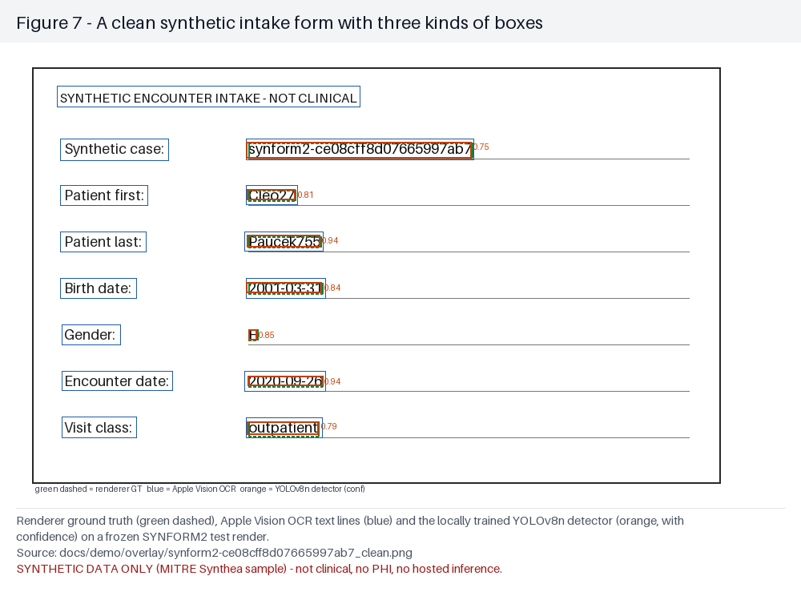
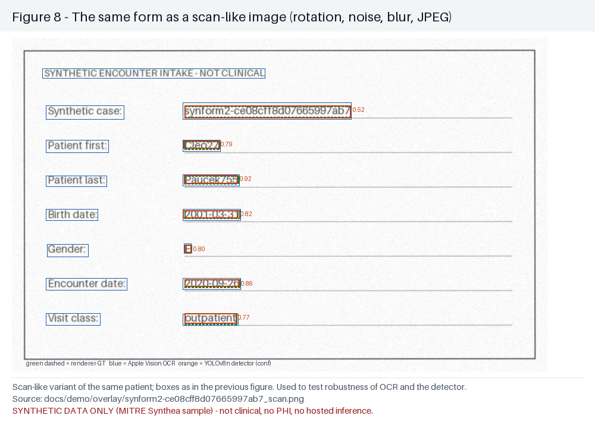
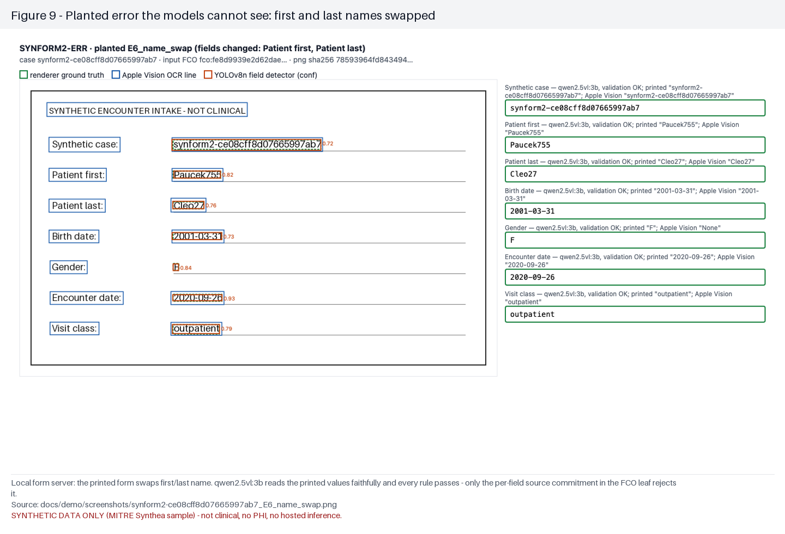
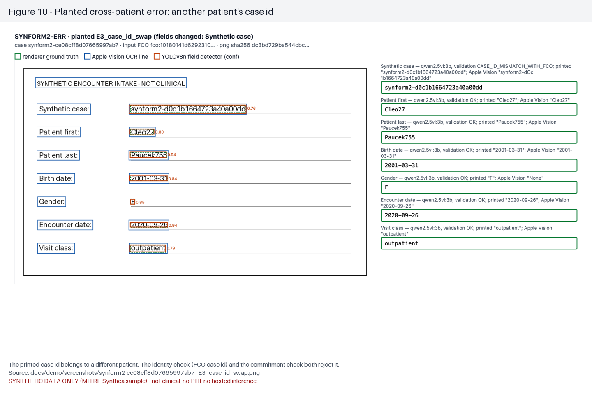
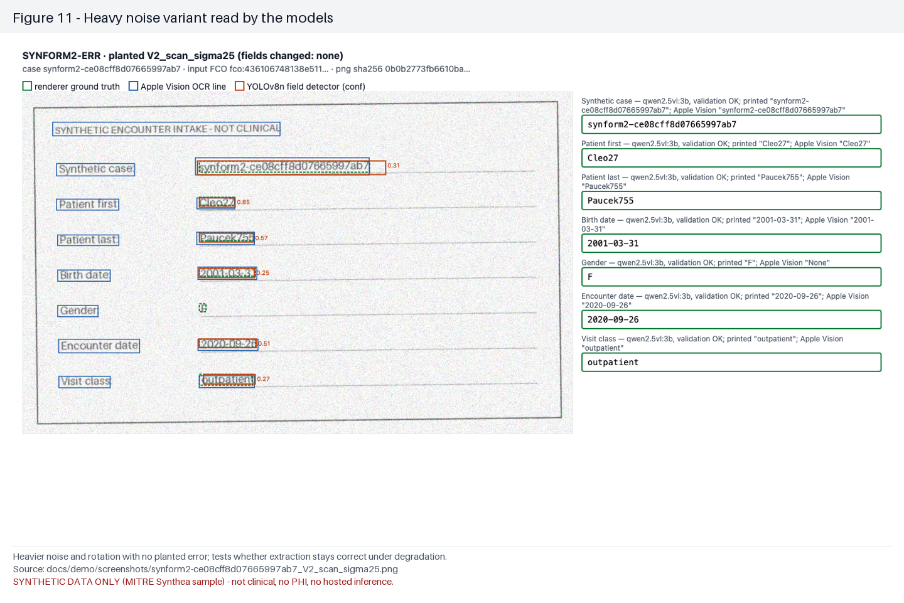
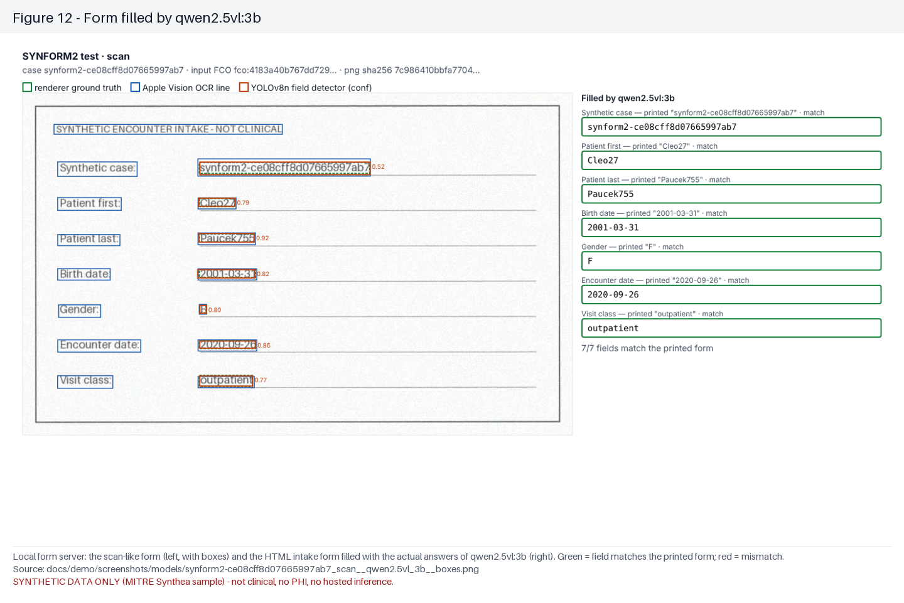
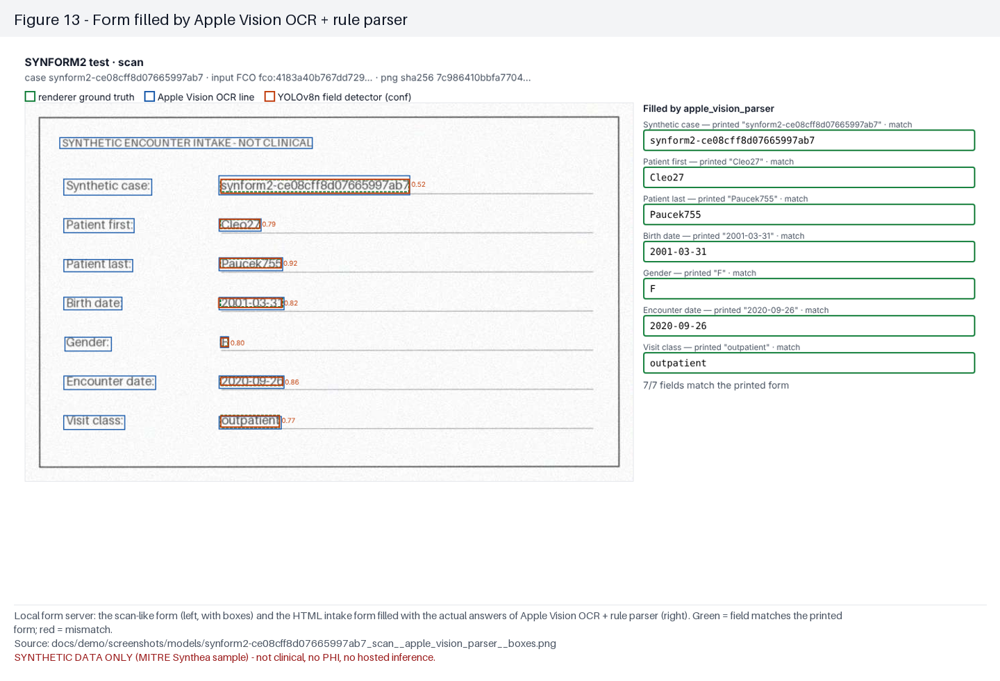
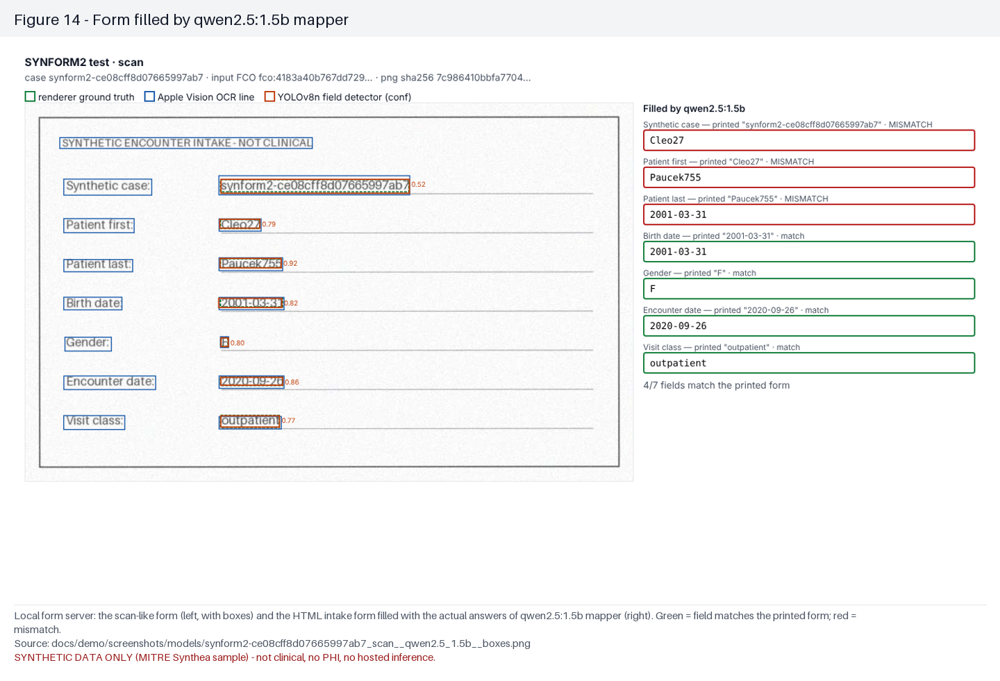
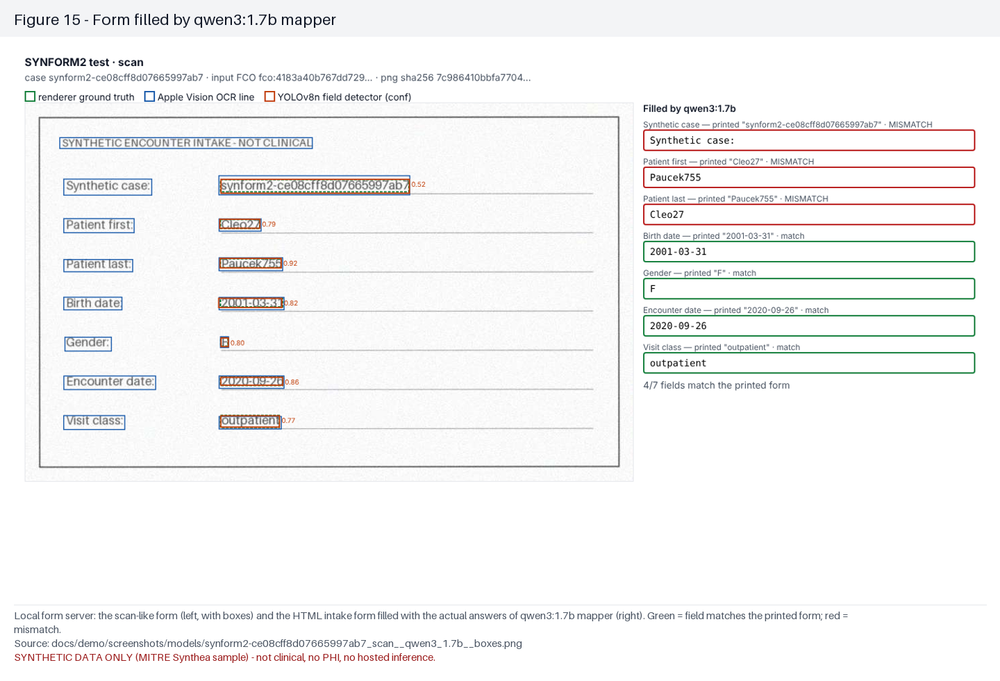
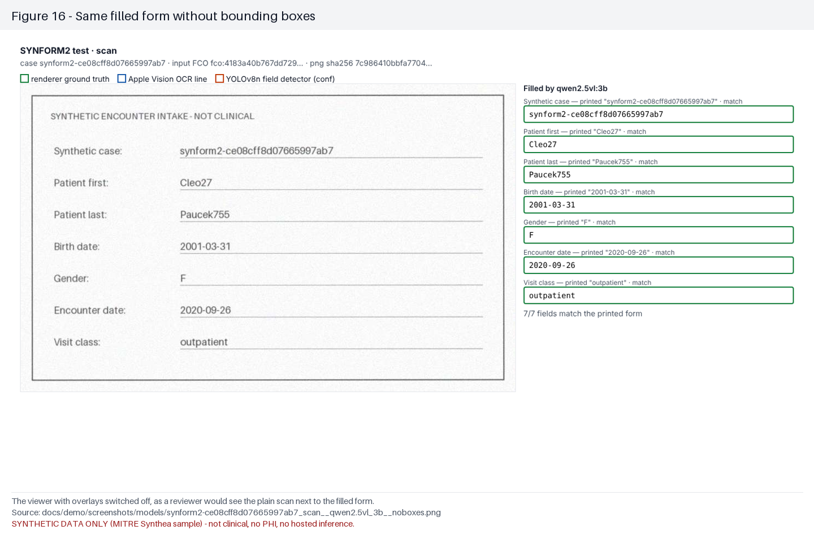

> **Video-friendly overview:** [Two-actor local/private Frontier Forms evidence storyboard](VIDEO_EVIDENCE_STORYBOARD_20261102.html), [video opening protocol and sponsor handoff](VIDEO_START_HERE_20261102.md), [frozen source manifest](VIDEO_EVIDENCE_MANIFEST_20261102.json). Interactive HTML requires a localhost static server; GitHub Pages availability has not been verified. The separate [Claude per-cell gains heatmap](../figures/gains_heatmap.html) is linked from the repository start page after PR #65.

# Figures for judges

SYNTHETIC DATA ONLY (MITRE Synthea sample) — not clinical, no PHI, no hosted inference.

All figures are generated by `scripts/redteam/make_judge_figures.py` from files in this repository; captions state the data source.

## Figure 1 — What we accomplished: workstreams × evidence stage

Each row is a workstream across all 34 pull requests (27 merged, 4 open, 3 closed as superseded). Blue cells = the PRs show that stage was reached. Outcome keeps the honest result: NEGATIVE / NULL results and BLOCKED lanes (hosted inference, Snyk) are shown, not hidden. No workstream is SUPPORTED yet: that needs McNemar + bootstrap + an independent replication cohort + guardrails.

*Source:* `docs/judges/pr_inventory.json (built from every PR in biobitworks/frontier-forms)`

## Figure 2 — Which admission checks catch planted form errors (16 combinations)

135 planted-error form images (945 field cells): qwen2.5vl:3b extraction checked by identity (FCO case id), deterministic rules (Lean-checked), per-field source commitments in the FCO leaf, and agreement with Apple Vision OCR. Darker = larger. * = Holm-corrected exact McNemar p<0.05 and bootstrap lower 95% CI > 0 vs no checks. The commitment leaf alone reaches 1.00 detection with 0 false admissions; it needs the source record to exist.

*Source:* `evidence/redteam/gate_factorial.json`

## Figure 3 — Field accuracy by model on the frozen test forms

Same 46 synthetic test forms (23 patients × clean + scan-like render). A field counts only if it exactly matches the printed value after normalisation. These are model (weights) comparisons, not harness gains. Qwen text mappers read the same Apple Vision OCR lines as the rule parser and do worse.

*Source:* `evidence/redteam/lanes/{VLM,OCR,MAP}_*_synform2_test_PUBLIC.jsonl`

## Figure 4 — Training over time: every epoch committed as a Merkle leaf (GAIN / LOSS / NEUTRAL)

Local YOLOv8n field-box detector trained on the SYNFORM2 train split; after every epoch the weights are hashed, scored on the dev split (field box IoU ≥ 0.5, 308 boxes), compared with the previous epoch (exact McNemar + stratified bootstrap) and committed to a hash chain. Test (touched once): full mAP50 0.912, 315/322 boxes; LOMO no-scan mAP50 0.857, 316/322. Chain roots 1fc600162b6a… / e99fe22c7a14….

*Source:* `evidence/redteam/detector/{full,no_scan}/epoch_ledger.jsonl, chain_manifest.json, final_receipt.json`

## Figure 5 — Every promotion decision, including negative and null results

One row per decision. PROMOTE requires Holm-corrected exact McNemar p<0.05 and a stratified-bootstrap lower 95% CI > 0, and is labelled discovery because the replication cohort is NOT_TESTED. NEGATIVE, NULL, LOSS, NEUTRAL, BLOCKED and NOT_TESTED rows are kept on purpose. Tint repeats the word in the Decision column (blue = promote/gain, grey = null/neutral, red = negative/loss, orange = blocked/not tested).

*Source:* `evidence/redteam/attribution_matrix.json, gate_factorial.json, detector/*/epoch_ledger.jsonl, trained_gain/trained_gain_summary.json, docs/judges/pr_inventory.json`

## Figure 6 — Trained local models vs the untrained baseline (test split, scored once)

Preregistered before the test split was scored (scripts/redteam/trained_gain_eval.py, committed first). Endpoint: forms with all 7 fields correct, 46 held-out images (23 patients x clean + scan). The learned correction was fit only on the 132 training images: strip spaces in every field (no training value contains one) plus character rules seen at least twice and never contradicted (Synthetic case: O->0). It is the only trained arm that is promoted, at discovery grade because the replication cohort is NOT_TESTED. The trained YOLOv8n detector finds fields well (mAP50 0.912) but OCR on its crops is NULL, and so is crops plus correction.

*Source:* `evidence/redteam/trained_gain/trained_gain_summary.json, trained_gain_rows.json`

## Figure 7 — A clean synthetic intake form with three kinds of boxes

Renderer ground truth (green dashed), Apple Vision OCR text lines (blue) and the locally trained YOLOv8n detector (orange, with confidence) on a frozen SYNFORM2 test render.

*Source:* `docs/demo/overlay/synform2-ce08cff8d07665997ab7_clean.png`

## Figure 8 — The same form as a scan-like image (rotation, noise, blur, JPEG)

Scan-like variant of the same patient; boxes as in the previous figure. Used to test robustness of OCR and the detector.

*Source:* `docs/demo/overlay/synform2-ce08cff8d07665997ab7_scan.png`

## Figure 9 — Planted error the models cannot see: first and last names swapped

Local form server: the printed form swaps first/last name. qwen2.5vl:3b reads the printed values faithfully and every rule passes — only the per-field source commitment in the FCO leaf rejects it.

*Source:* `docs/demo/screenshots/synform2-ce08cff8d07665997ab7_E6_name_swap.png`

## Figure 10 — Planted cross-patient error: another patient's case id

The printed case id belongs to a different patient. The identity check (FCO case id) and the commitment check both reject it.

*Source:* `docs/demo/screenshots/synform2-ce08cff8d07665997ab7_E3_case_id_swap.png`

## Figure 11 — Heavy noise variant read by the models

Heavier noise and rotation with no planted error; tests whether extraction stays correct under degradation.

*Source:* `docs/demo/screenshots/synform2-ce08cff8d07665997ab7_V2_scan_sigma25.png`

## Figure 12 — Form filled by qwen2.5vl:3b

Local form server: the scan-like form (left, with boxes) and the HTML intake form filled with the actual answers of qwen2.5vl:3b (right). Green = field matches the printed form; red = mismatch.

*Source:* `docs/demo/screenshots/models/synform2-ce08cff8d07665997ab7_scan__qwen2.5vl_3b__boxes.png`

## Figure 13 — Form filled by Apple Vision OCR + rule parser

Local form server: the scan-like form (left, with boxes) and the HTML intake form filled with the actual answers of Apple Vision OCR + rule parser (right). Green = field matches the printed form; red = mismatch.

*Source:* `docs/demo/screenshots/models/synform2-ce08cff8d07665997ab7_scan__apple_vision_parser__boxes.png`

## Figure 14 — Form filled by qwen2.5:1.5b mapper

Local form server: the scan-like form (left, with boxes) and the HTML intake form filled with the actual answers of qwen2.5:1.5b mapper (right). Green = field matches the printed form; red = mismatch.

*Source:* `docs/demo/screenshots/models/synform2-ce08cff8d07665997ab7_scan__qwen2.5_1.5b__boxes.png`

## Figure 15 — Form filled by qwen3:1.7b mapper

Local form server: the scan-like form (left, with boxes) and the HTML intake form filled with the actual answers of qwen3:1.7b mapper (right). Green = field matches the printed form; red = mismatch.

*Source:* `docs/demo/screenshots/models/synform2-ce08cff8d07665997ab7_scan__qwen3_1.7b__boxes.png`

## Figure 16 — Same filled form without bounding boxes

The viewer with overlays switched off, as a reviewer would see the plain scan next to the filled form.

*Source:* `docs/demo/screenshots/models/synform2-ce08cff8d07665997ab7_scan__qwen2.5vl_3b__noboxes.png`

## Figure 17 — Drawing boxes on an image breaks OCR

Same 10 forms, same OCR engine and parser; the only change is the drawn bounding boxes. Lesson: run OCR on the clean render and keep overlays for humans.

*Source:* `docs/demo/ocr_boxes_vs_clean.json`

## Not included (input missing at build time)

- preview captures

## Figure 11 — Independent complete outcome and training-epoch heatmap

Open JUDGE_OUTCOME_HEATMAP_V1.html and JUDGE_OUTCOMES_SUCCESSOR_V1.json. Independent ChatGPT review of **82 exact outcome leaves**: 60 actual YOLO checkpoints across full/no-scan arms (full = three GAIN, three LOSS, 23 NEUTRAL and initial; no-scan = three GAIN, one LOSS, 25 NEUTRAL and initial); 12 FCO single-leaf contrasts with McNemar, Holm and patient-cluster bootstrap; six injected-error detector contrasts; learned box predictor and random-forest negative comparisons; FCAR scientific admission HOLD. Source root 71d3bdac181ca273537a4493ea967a41bd618eabfc83590c750b633d180ceae6. A changed root never establishes causal model gain.

## Figure 12 — Claude learned OCR correction, independently reanalyzed

Open FIG12_OCR_CORRECTION_ABLATION_V1.html and OCR_CORRECTION_SUCCESSOR_V2.json. Original fitted correction table and test: **Claude Code, PRs #51 and #58**; 23 synthetic cases each rendered clean and scanned (46 images, seven fields). Independent check by **ChatGPT** confirms A0 14/46 all-correct, A1 correction 22/46, A2 YOLO crop OCR 9/46, A3 crop+correction 15/46. For A1: exact paired McNemar p=0.0078125, three-comparison Holm p=0.0234375; 10,000 **patient-cluster** resamples grouping each clean+scan pair gave 95% CI +4.35 to +32.61 percentage points. Crop arms are NULL. A1 is an improvement on the studied synthetic sample but is a **trained OCR text-correction table**, not a Qwen/DAISY neural weight gain. Pretest preregistration chronology and independent second-cohort replication are NOT_VERIFIED. Scientific promotion remains HOLD. New independently computed three-arm root 5acbf8276ed1c184423ea68b9973acec96a3a47e030d296f83e23c1c005071cb is explicitly linked as a successor of, not a rewrite to, the frozen 82-event root.

## Judge synthetic demo manifest repair — independent ChatGPT

Claude Code's Figures 1–10, PNG screenshots, 10 synthetic PDFs and visual overlays are unchanged. Original manifest had 10 incorrect annotation JSON hashes. Earlier FAILED manifest preserved as docs/demo/manifest_v1_pre_repair.json; successor repairs all ten, independently checks every one of 62 assets against its actual byte size and SHA256, and records verified 62-leaf asset root 227a1786183dc2535c5aeb54c28ace33c3c6b803584480eb97b646bbffcc444c. Asset root is not a clinical or model outcome; CI independently enforces this preservation.

## Figures 18–20 — grounded contributor Gantt and recorded training history

- **Figure 18, FAILED predecessor:** [original Gantt PNG](figures/fig18_pr_contributor_gantt_20261102.png) used a label that displayed **0 mixed PRs**, inconsistent with the 43 mixed/unknown PRs in the frozen source. Preserved rather than silently overwritten.
- **Figure 20, corrected successor:** [Four-lane contributor Gantt PNG](figures/fig20_contributor_gantt_corrected_v2.png), with 63 source-read GitHub PR timestamps, four lane categories and an explicit 4:30 PM competition cutoff. Source [63-PR snapshot](FINAL_PR_SNAPSHOT_20261102_V3.json), [byte-level correction receipt](FINAL_JUDGE_TIMELINE_PRESENTATION_CORRECTION_V2.json).
- **Figure 19, genuine recorded training:** [Training and discovery PNG](figures/fig19_actual_training_epochs_20261102.png). Distinct 40-epoch new YOLOv8n MPS mAP50–95(B) curve, older 30+30 epoch full/no-scan development-image success curves (with regressions and ties), plus different-denominator FCO/OCR synthetic discovery pairs. Source [source-hash-pinned timeline JSON](FINAL_JUDGE_LANE_TRAINING_TIMELINE_V1.json), [V2 detector summary](../../evidence/forms_detector/V2-yolov8n/summary.json), and [independent experimental outcomes](JUDGE_OUTCOMES_SUCCESSOR_V1.json).

**Attribution and chronology ceiling:** PR timestamp is not model runtime. V2 40-epoch metrics lack a separate UTC for each epoch; the older 30-epoch logs include actual UTC. The 63-PR snapshot was read after the 4:30 PM cutoff. The new detector localizes boxes well but remains PARTIAL on held-out class identity and flags. FCAR scientific promotion HOLD; no DAISY model, data, score or Merkle root imported.

## Figure 21 — judge-facing V3 presentation preview (visual-only successor)

[Preview image](figures/fig21_presentation_v3_preview_20261102.png) · [Team-wide presentation V3](present_v3.html) · [V3 source template](../../scripts/redteam/present_page_template_v3.html) · [Build script](../../scripts/redteam/build_present_page_v3.py) · [Byte-level display successor receipt](PRESENTATION_VISUAL_V3_SUCCESSOR_20261102.json).

V3 adds a UTF-8 document declaration, replaces the Claude-only heading with a verified team-wide attribution overview, adds a short two-comparison summary and source-labeled 63-PR/100-epoch figures, and corrects the judge README order so Qwen SFT training is beneath completed results. The screenshot is a *rendered browser capture of the V3 page*, not a newly trained model, new metric or external deployment. Previous v1/v2 pages are unchanged. The original 63-PR snapshot remains a historical predecessor; post-deadline work does not establish contest eligibility.

The HTML source link on GitHub is not a hosted live application. For interactive charts serve the checkout from its root over a local HTTP server; for external judges the static preview and PNG/CSV evidence are publicly viewable without running code.
